# Analyse des performances des employés — Python & R

> **Outils** : Python (pandas, matplotlib, seaborn) | R (dplyr, ggplot2) 
> **Durée** : ~4 heures

---

## Problématique métier

Une entreprise souhaite **analyser la répartition des performances** de ses 1 470 employés pour comprendre les écarts entre départements, identifier les facteurs de satisfaction et détecter les profils atypiques (**outliers**).

> *« Quels employés sont outliers en termes de salaire ? Y a-t-il un biais dans notre système d'évaluation ? Quels départements sont les plus satisfaits ? »*

---

## Objectifs du projet

- Explorer et nettoyer le dataset RH avec **pandas**
- Calculer les **statistiques descriptives** (moyenne, médiane, quartiles, écart-type)
- Créer **6 visualisations** (histogrammes, boxplots, pie charts, heatmap)
- Détecter les **outliers** avec la règle des **1.5 × IQR**
- Reproduire l'analyse avec **R** (dplyr + ggplot2)
- Identifier les **insights actionnables** pour les RH

---

## Outils & compétences mobilisées

| Compétence | Python | R |
|---|---|---|
| Chargement des données | `pd.read_csv()` | `read_csv()` |
| Exploration | `.info()`, `.describe()` | `glimpse()`, `summary()` |
| Nettoyage | `.drop()`, `.isnull()` | `select()`, `filter()` |
| Statistiques | `pandas`, `scipy` | `dplyr` |
| Visualisation | `matplotlib`, `seaborn` | `ggplot2` |
| Outliers | Règle 1.5 × IQR | Règle 1.5 × IQR |

---

## Le dataset

**Source** : [IBM HR Analytics Dataset (Kaggle)](https://www.kaggle.com/datasets/pavansubhasht/ibm-hr-analytics-attrition-dataset)

| Caractéristique | Détail |
|---|---|
| Lignes | 1 470 employés |
| Colonnes | 35 variables (32 après nettoyage) |
| Variables numériques | 26 |
| Variables catégorielles | 9 |
| Valeurs manquantes | 0 |
| Doublons | 0 |

---

## Méthodologie

### 1. Nettoyage des données

- **0 valeur manquante** détectée 
- **0 doublon** détecté 
- **3 colonnes constantes supprimées** : `EmployeeCount`, `Over18`, `StandardHours`
- Dataset final : **1 470 lignes × 32 colonnes**

### 2. Statistiques descriptives

| Variable | Moyenne | Médiane | Écart-type | Min | Max |
|---|---|---|---|---|---|
| Age | 36,9 ans | 36 ans | 9,1 | 18 | 60 |
| MonthlyIncome | $6 503 | $4 919 | $4 707 | $1 009 | $19 999 |
| YearsAtCompany | 7,0 ans | 5 ans | 6,1 | 0 | 40 |
| JobSatisfaction | 2,73 / 4 | 3 / 4 | 1,10 | 1 | 4 |
| PerformanceRating | 3,15 / 4 | 3 / 4 | 0,36 | 3 | 4 |

### 3. Détection des outliers (règle 1.5 × IQR)

| Variable | Borne sup. | Nb outliers | % |
|---|---|---|---|
| MonthlyIncome | $17 458 | 83 | 5,6% |
| YearsAtCompany | 22 ans | 45 | 3,1% |
| DistanceFromHome | 39 km | 10 | 0,7% |
| NumCompaniesWorked | 8 | 45 | 3,1% |

---

## Visualisations — Python

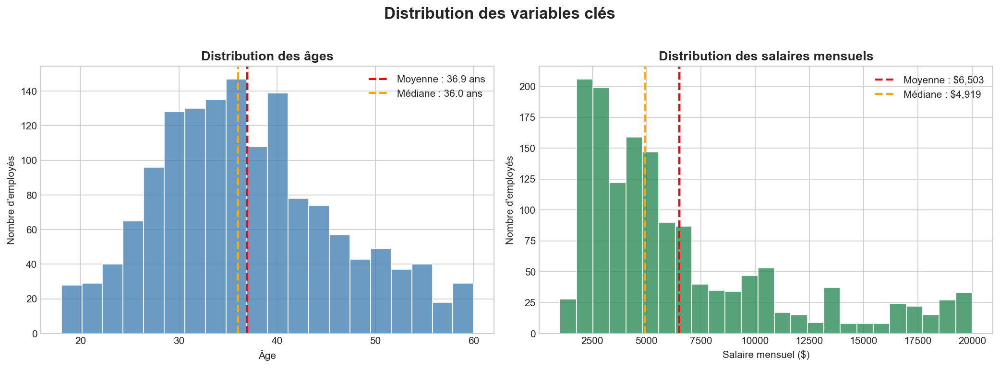

> Distributions Age & Salaire — L'âge suit une distribution quasi-normale (moyenne 36,9 ans). Le salaire montre une forte asymétrie à droite : la médiane ($4 919) est bien inférieure à la moyenne ($6 503), indiquant une minorité de très hauts salaires.

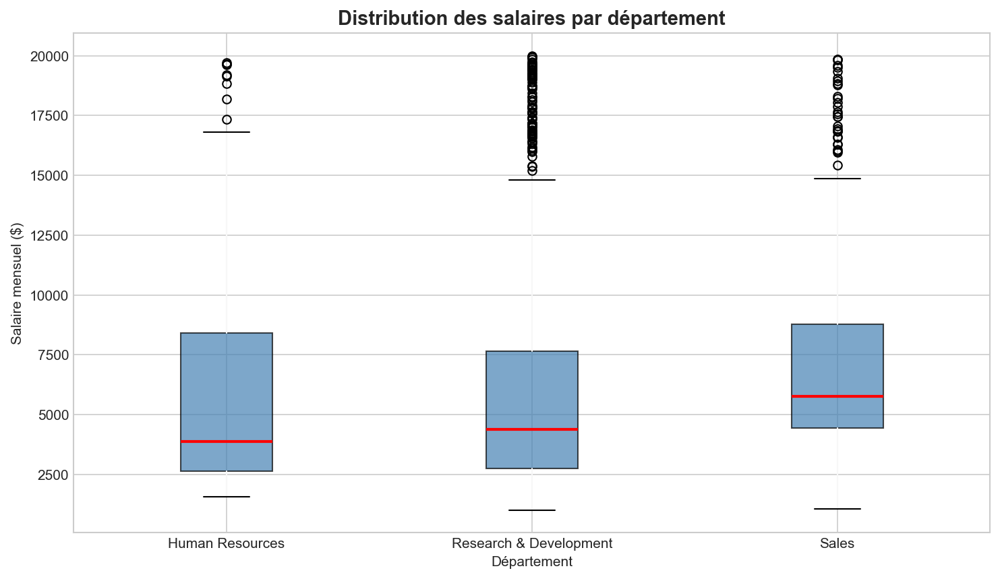

> Salaires par département — R&D est le département le mieux rémunéré, suivi de Sales puis HR. Les boxplots révèlent 83 outliers salariaux au-delà de $17 458/mois.

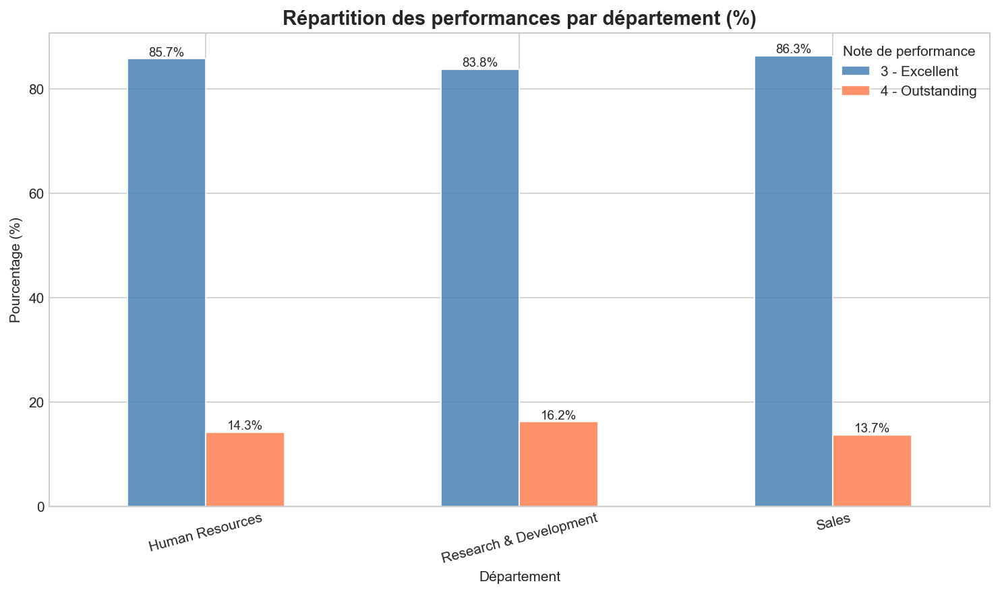

> Performance par département — Biais d'évaluation détecté : 100% des employés sont notés 3 ("Excellent") ou 4 ("Outstanding"). Aucun employé n'est noté 1 ou 2, rendant ce système non discriminant.

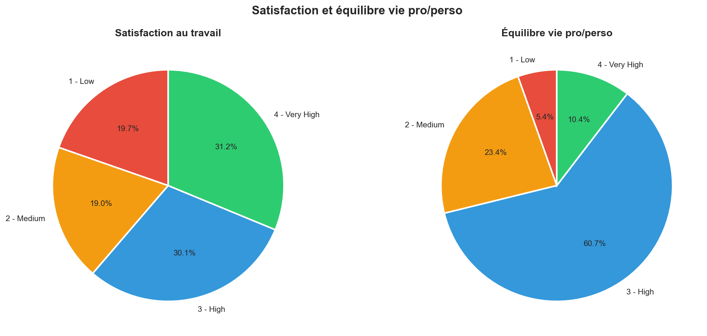

> Satisfaction & Work-Life Balance — 59,4% des employés ont une satisfaction élevée (3-4), mais 40,6% sont insatisfaits (1-2). 60,7% ont un bon équilibre vie pro/perso.

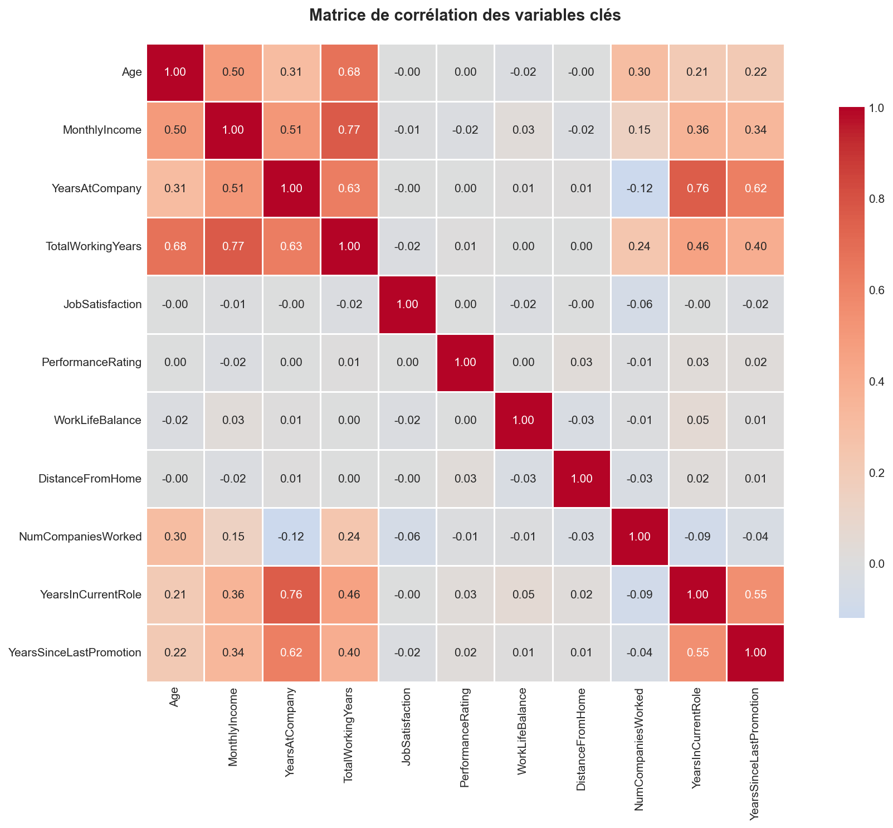

> Matrice de corrélation — Corrélations fortes identifiées : MonthlyIncome ↔ TotalWorkingYears (logique salariale), Age ↔ YearsAtCompany, YearsAtCompany ↔ YearsInCurrentRole.

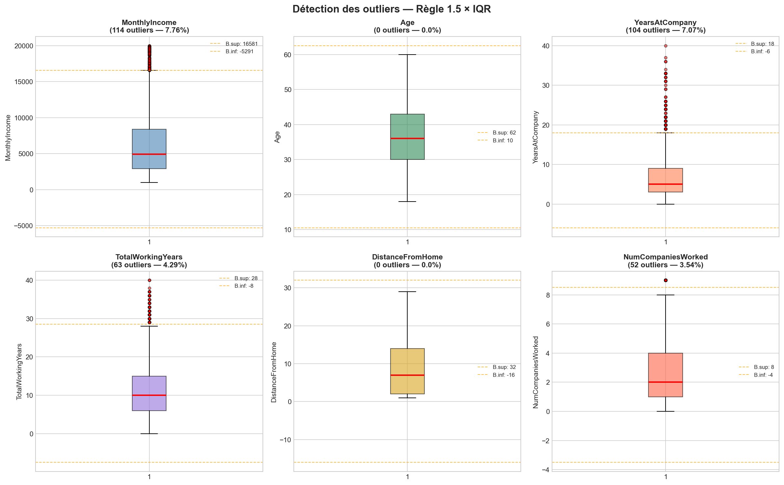

> Détection des outliers (règle 1.5 × IQR) — Les boxplots montrent les valeurs atypiques en salaire, ancienneté, distance domicile-travail et nombre d'entreprises précédentes.

---

## Visualisations — R (ggplot2)

La même analyse reproduite avec R (dplyr + ggplot2) confirme les résultats obtenus avec Python :

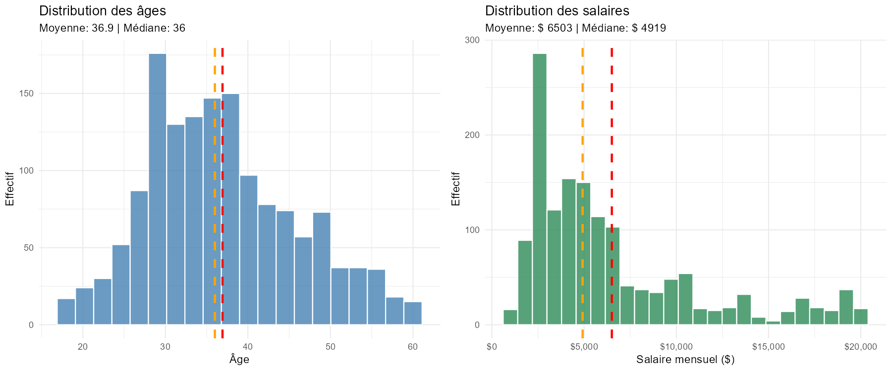

> Distributions Age & Salaire (R / ggplot2) — Histogrammes avec densité. Mêmes observations : distribution normale pour l'âge, forte asymétrie à droite pour les salaires.

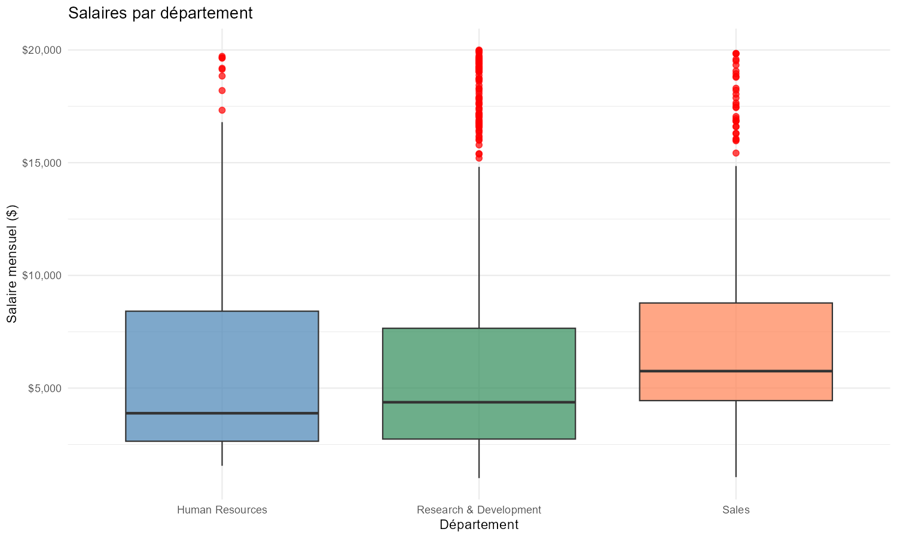

> Salaires par département (R / ggplot2) — Boxplots confirmant R&D comme département le mieux rémunéré, avec les mêmes outliers identifiés.

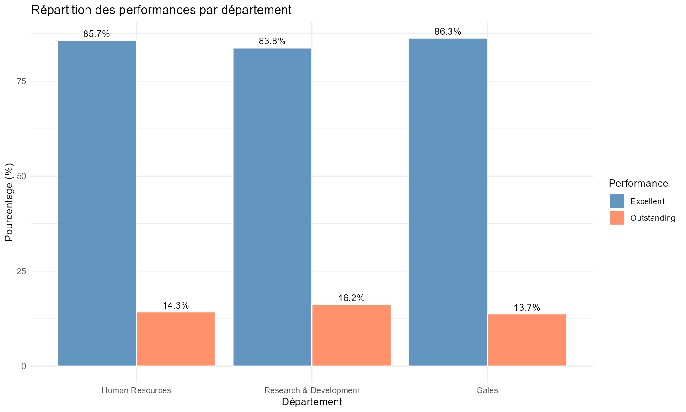

> Performance par département (R / ggplot2) — Le biais d'évaluation (100% notés 3 ou 4) est confirmé avec la même distribution.

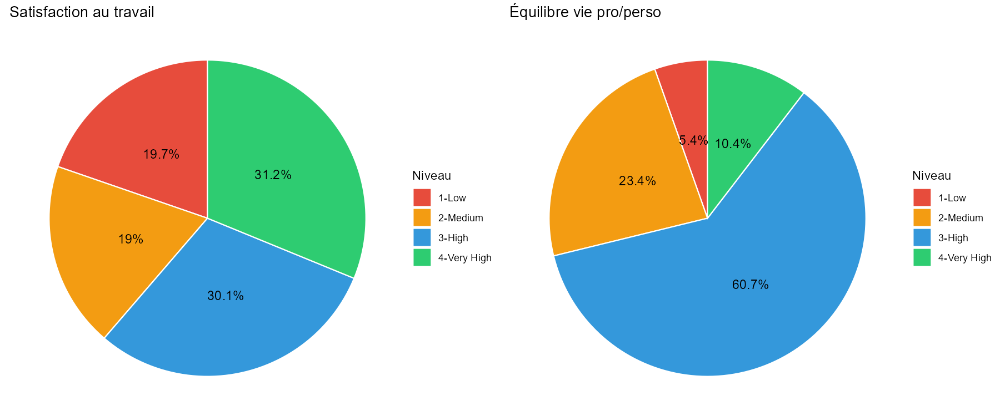

> Satisfaction & Work-Life Balance (R / ggplot2) — Proportions identiques : 59,4% satisfaction élevée, 60,7% bon équilibre vie pro/perso.

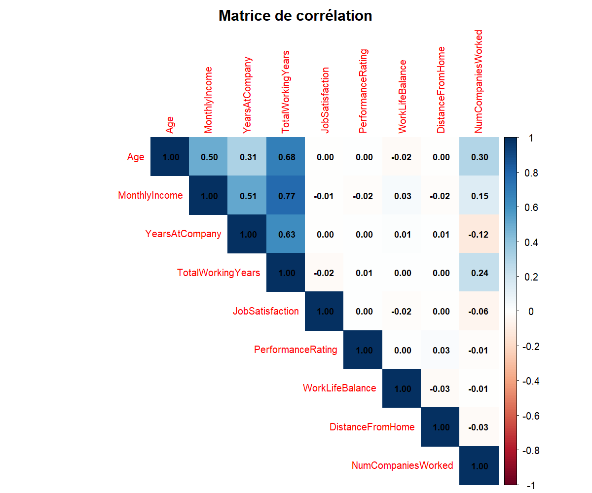

> Matrice de corrélation (R / ggplot2) — Mêmes corrélations fortes identifiées : MonthlyIncome ↔ TotalWorkingYears, Age ↔ YearsAtCompany.

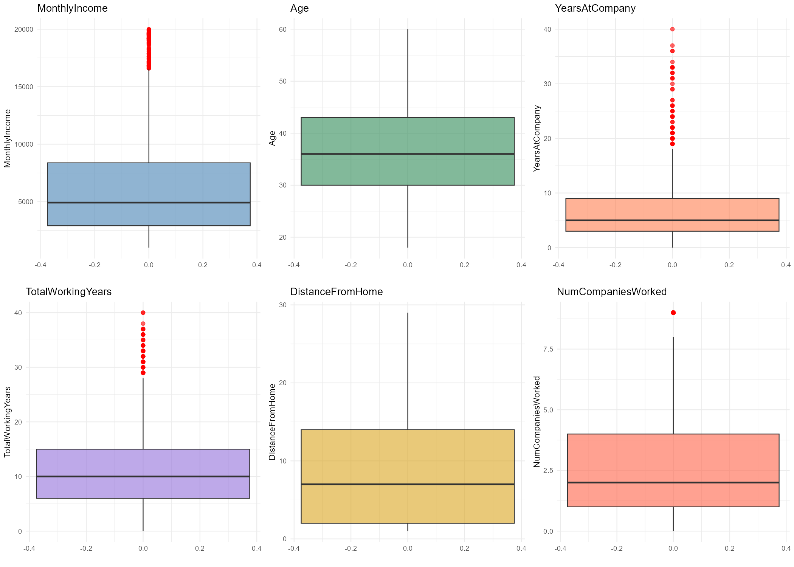

> Détection des outliers (R / ggplot2) — Règle 1.5 × IQR appliquée avec les mêmes seuils et résultats que la version Python.

---

## Principaux insights business

### Performances
- **Biais d'évaluation détecté** : 100% des employés ont une note de 3 ou 4. Ce système ne discrimine pas les performances.
- **84,9%** sont notés "Excellent" (3), **15,1%** "Outstanding" (4)

### Salaires
- **R&D** est le département le mieux payé
- **83 outliers salariaux** (5,6%) gagnent plus de $17 458/mois
- Le salaire médian ($4 919) est très inférieur à la moyenne ($6 503) → **distribution asymétrique**

### Satisfaction
- **59,4%** ont une satisfaction élevée ou très élevée (3-4)
- **40,6%** ont une satisfaction faible ou moyenne (1-2) → levier d'amélioration important
- **60,7%** ont un bon équilibre vie pro/perso (3-4)

---

## Recommandations RH

1. ** Revoir le système d'évaluation** : un système où 100% ont une note "bonne ou excellente" n'aide pas à identifier les vrais talents.
2. **Analyser les outliers salariaux** : 83 employés gagnent 3× le salaire médian. Postes stratégiques ?
3. ** Plan d'action satisfaction** : 40% d'insatisfaits est un signal d'alarme.
4. ** Work-Life Balance** : 39% ont un mauvais équilibre. Explorer télétravail et flexibilité.
5. **Risque de turnover** : croiser satisfaction faible + salaire bas + mauvais équilibre pour identifier les profils à risque.

---

## Compétences démontrées

- Exploration de données structurée et reproductible
- Nettoyage intelligent (suppression colonnes constantes, vérification doublons/NA)
- Statistiques descriptives complètes
- 6 visualisations variées et pertinentes
- Détection d'outliers avec implémentation IQR from scratch
- Interprétation business des résultats statistiques
- Code Python propre avec commentaires et fonctions réutilisables
- Analyse comparative Python vs R

---

## Structure du projet

```
02-hr-analytics-python-r/
├── dataset/
│ └── hr_analytics.csv
├── notebooks/
│ ├── python/
│ │ └── 02_hr_analytics_python.ipynb
│ └── r/
│ └── 02_hr_analytics_r.Rmd
├── images/
│ ├── 01_distributions.png
│ ├── 02_salaire_departement.png
│ ├── 03_performance_departement.png
│ ├── 04_satisfaction.png
│ ├── 05_correlation.png
│ ├── 06_outliers_boxplots.png
│ ├── r_01_distributions.png
│ ├── r_02_salaires_dept.png
│ ├── r_03_performance_dept.png
│ ├── r_04_satisfaction.png
│ ├── r_05_correlation.png
│ └── r_06_outliers.png
├── reports/
└── README.md
```

---

## Pour reproduire ce projet

```bash
# 1. Cloner le repo
git clone https://github.com/barde44/portfolio-data-analyst.git
cd portfolio-data-analyst/02-hr-analytics-python-r

# 2. Installer les dépendances Python
pip install pandas numpy matplotlib seaborn scipy jupyter

# 3. Lancer le notebook Python
jupyter notebook notebooks/python/02_hr_analytics_python.ipynb

# 4. Pour R : ouvrir notebooks/r/02_hr_analytics_r.Rmd dans RStudio
```

---

## À propos

**Portfolio complet** : [github.com/barde44/portfolio-data-analyst](https://github.com/barde44/portfolio-data-analyst)
