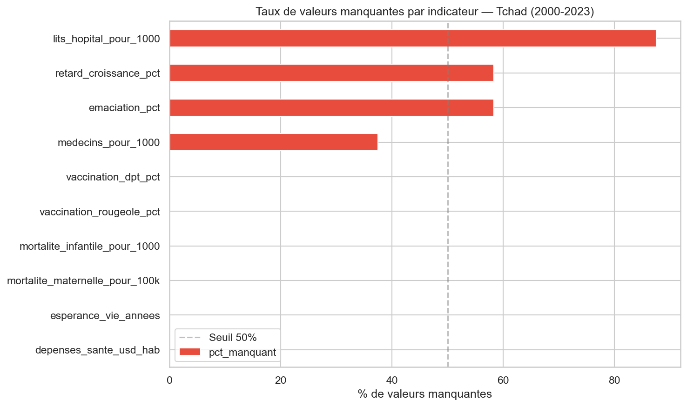
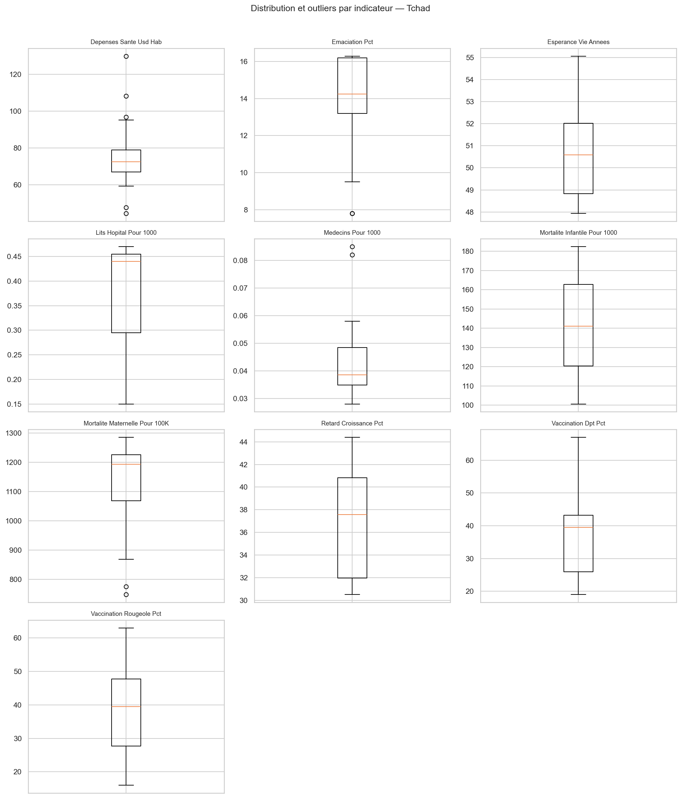
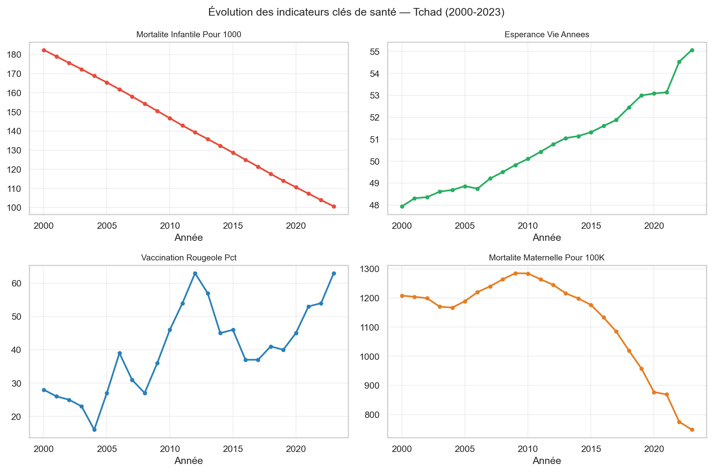

# Nettoyage de données — Indicateurs de santé au Tchad

> **Outils** : Python (pandas, numpy, requests, matplotlib, seaborn) 
> **Source** : API Banque Mondiale 
> **Niveau** : Intermédiaire

---

## Problématique métier

Le Tchad fait face à des défis sanitaires majeurs : mortalité infantile élevée, couverture vaccinale instable, pénurie de personnel médical. Les organisations internationales et les ONG s'appuient sur les **données de la Banque Mondiale** pour orienter leurs programmes, mais ces données présentent de nombreux problèmes de qualité : **24,2% de valeurs manquantes**, formats incohérents et outliers non traités.

> *« Peut-on obtenir un dataset fiable de 10 indicateurs de santé pour le Tchad (2000–2023) afin de suivre l'évolution des politiques de santé publique ? Quels indicateurs sont les plus lacunaires ? Comment imputer les données manquantes sans biaiser les tendances ? »*

L'objectif est de **nettoyer et préparer ce jeu de données** pour qu'il soit exploitable par les analystes et décideurs du secteur humanitaire.

---

## Objectifs du projet

- Extraire **10 indicateurs de santé** via l'API REST de la Banque Mondiale
- Analyser la **qualité des données** (complétude, cohérence, types)
- Traiter les **valeurs manquantes** par interpolation linéaire adaptée aux séries temporelles
- Détecter les **outliers** avec la méthode IQR
- Valider la **cohérence croisée** entre indicateurs (ex : mortalité vs espérance de vie)
- Exporter un **dataset nettoyé** en CSV avec un rapport de qualité
- Publier le projet sur **GitHub** avec une documentation professionnelle

---

## Outils & compétences mobilisées

| Compétence | Détail |
|---|---|
| **Extraction de données** | API REST Banque Mondiale (`api.worldbank.org/v2`) |
| **Exploration** | `pandas` (`.info()`, `.describe()`, `.isnull()`) |
| **Nettoyage** | Interpolation linéaire, imputation par médiane, standardisation des types |
| **Détection d'outliers** | Méthode IQR (1.5 × écart interquartile) |
| **Validation** | Vérification de cohérence croisée entre indicateurs |
| **Visualisation** | `matplotlib`, `seaborn` (heatmaps, boxplots, courbes) |
| **Git / GitHub** | Versionning, README professionnel, publication |

---

## Le dataset

**Source** : [World Bank Open Data](https://data.worldbank.org)

| Indicateur | Code | Unité |
|---|---|---|
| Mortalité infantile (< 5 ans) | SH.DYN.MORT | pour 1 000 naissances |
| Retard de croissance (stunting) | SH.STA.STNT.ZS | % enfants < 5 ans |
| Émaciation (wasting) | SH.STA.WAST.ZS | % enfants < 5 ans |
| Vaccination rougeole | SH.IMM.MEAS | % enfants 12-23 mois |
| Vaccination DPT | SH.IMM.IDPT | % enfants 12-23 mois |
| Espérance de vie | SP.DYN.LE00.IN | années |
| Dépenses de santé par habitant | SH.XPD.CHEX.PP.CD | USD courants |
| Médecins pour 1 000 hab. | SH.MED.PHYS.ZS | ratio |
| Lits d'hôpital pour 1 000 hab. | SH.MED.BEDS.ZS | ratio |
| Mortalité maternelle | SH.STA.MMRT | pour 100 000 naissances |

| Caractéristique | Détail |
|---|---|
| Lignes | 240 (10 indicateurs × 24 années) |
| Période | 2000 – 2023 |
| Valeurs manquantes (avant) | 58 (24,2%) |
| Indicateur le plus lacunaire | Lits d'hôpital (87,5% manquant) |

---

## Méthodologie

### 1. Collecte des données

Extraction via l'API REST de la Banque Mondiale (`api.worldbank.org/v2`) pour le pays `TCD` (Tchad), sur la période 2000–2023, pour les 10 indicateurs sélectionnés.

### 2. Exploration et diagnostic

- Analyse de la structure, des types et de la complétude
- Identification des patterns de données manquantes par indicateur et par année
- Diagnostic : **58 valeurs manquantes** (24,2%), 0 doublon, formats hétérogènes

### 3. Nettoyage et imputation

- **Interpolation linéaire** pour les séries temporelles continues (vaccination, mortalité, espérance de vie)
- **Médiane** pour les données ponctuelles sans tendance claire
- **Standardisation** des types de données
- **37 valeurs imputées** au total

### 4. Détection des outliers

- Méthode **IQR (1.5 × écart interquartile)** appliquée à chaque indicateur
- Les dépenses de santé et la vaccination rougeole montrent la plus grande variabilité

### 5. Validation et export

- **Vérification de cohérence croisée** : la mortalité ne peut pas augmenter ET l'espérance de vie augmenter simultanément
- Export du dataset nettoyé en CSV + rapport de qualité

---

## Résultats du nettoyage

| Métrique | Avant | Après |
|---|---|---|
| Lignes totales | 240 | 240 |
| Valeurs manquantes | 58 (24,2%) | 21 (8,8%) |
| Doublons | 0 | 0 |
| Valeurs imputées (interpolation) | — | 37 |
| Réduction des manquantes | — | **63,8%** |

---

## Visualisations

### Carte des valeurs manquantes



### Détection des outliers



### Tendances des indicateurs clés



---

## Principaux insights (données réelles 2000–2023)

### Mortalité
- **Mortalité infantile** : baisse de 182 à 100 pour 1 000 naissances (**-45% en 24 ans**)
- **Mortalité maternelle** : forte baisse après 2018 (1 200 → 760 pour 100 000 naissances)

### Vaccination
- **Vaccination rougeole** : très volatile (15% à 65%), reflétant l'**instabilité des campagnes** de vaccination
- Les fluctuations rendent la planification difficile pour les organisations de santé

### Progrès
- **Espérance de vie** : hausse de 48 à 55 ans (**+7 ans**)
- Amélioration globale malgré des reculs ponctuels

### Lacunes de données
- **Lits d'hôpital** : 87,5% de données manquantes — indicateur le plus lacunaire
- **Médecins pour 1 000 hab.** : données très incomplètes, reflétant le manque de suivi statistique

---

## Recommandations

1. ** Qualité des données** : les indicateurs sur les infrastructures (lits, médecins) nécessitent un meilleur système de collecte au niveau national
2. ** Vaccination** : la volatilité de la couverture vaccinale appelle des programmes de vaccination plus stables et pérennes
3. **Suivi** : utiliser ce dataset nettoyé comme base pour un tableau de bord de suivi des ODD santé
4. **Automatisation** : planifier l'extraction et le nettoyage de manière périodique via l'API

---

## Compétences démontrées

- **Extraction de données** via API REST
- **Analyse de la qualité** des données (complétude, cohérence)
- **Imputation** par interpolation linéaire adaptée aux séries temporelles
- **Détection d'outliers** par méthode IQR
- **Validation croisée** de cohérence entre indicateurs
- **Visualisation** des résultats du nettoyage
- **Documentation professionnelle** du pipeline

---

## Pour reproduire ce projet

1. **Cloner le repository** :
 ```bash
 git clone https://github.com/barde44/portfolio-data-analyst.git
 cd portfolio-data-analyst/03-data-cleaning-health-chad
 ```

2. **Installer les dépendances** :
 ```bash
 pip install pandas numpy requests matplotlib seaborn
 ```

3. **Exécuter le notebook** : `notebooks/03_data_cleaning_chad_health.ipynb`

---

## Structure du projet

```
03-data-cleaning-health-chad/
├── dataset/
│ ├── raw/ # Données brutes de l'API
│ └── cleaned/ # Données nettoyées
├── notebooks/
│ └── 03_data_cleaning_chad_health.ipynb
├── images/ # Visualisations
└── README.md
```

---

## À propos

Ce projet fait partie d'un parcours de **12 projets pour devenir Data Analyst**, couvrant Excel, SQL, Python/R, Power BI et Tableau.

 **Me contacter** : [LinkedIn](https://www.linkedin.com/in/barde-steven/) | [Email](mailto:bardesteven17@gmail.com) 
**Portfolio complet** : [github.com/barde44/portfolio-data-analyst](https://github.com/barde44/portfolio-data-analyst)

---
 **Si ce projet t'a été utile, n'hésite pas à mettre une étoile sur le repo !**
