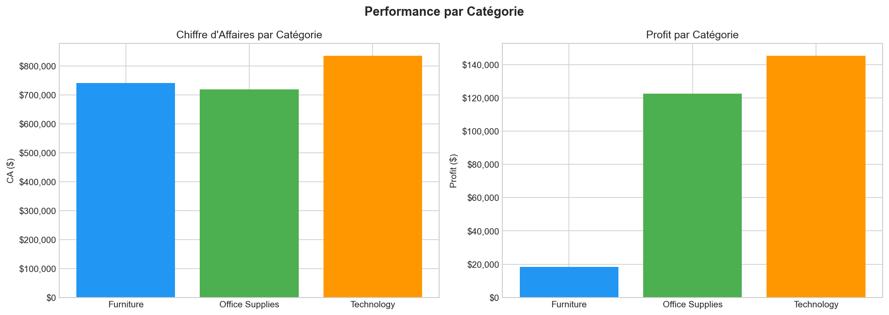
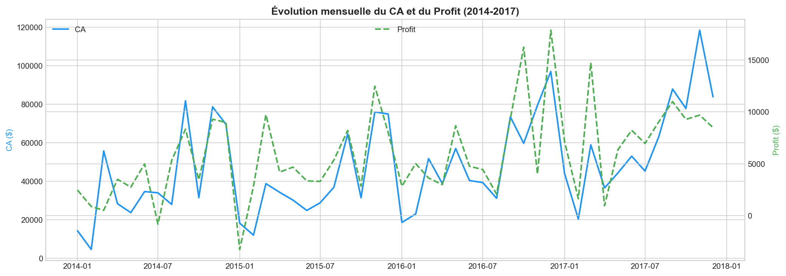
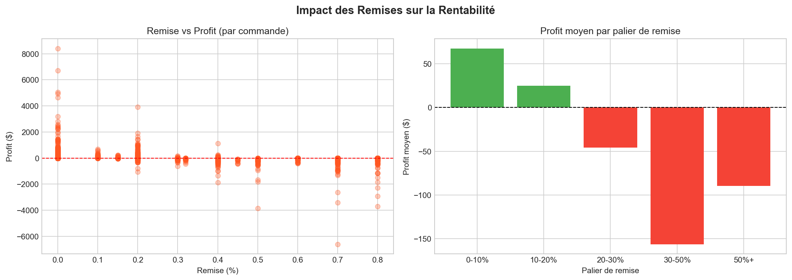
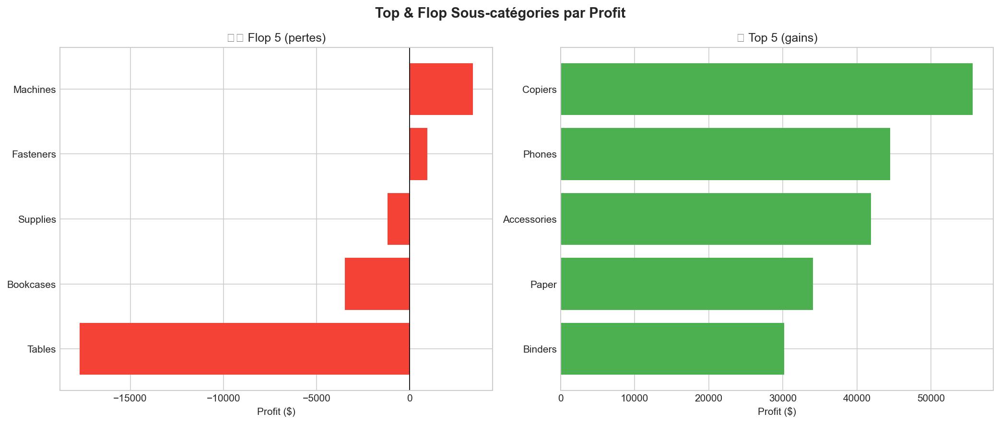
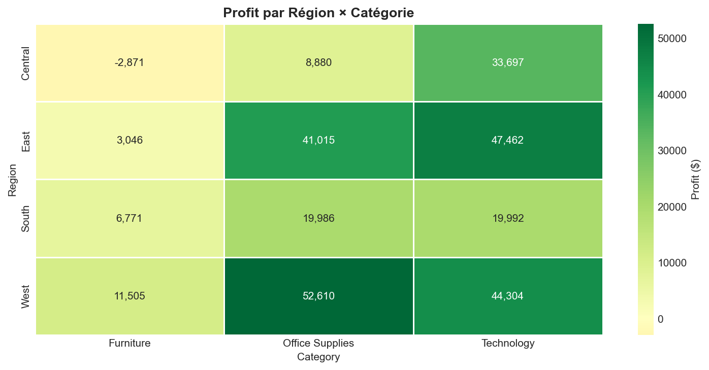
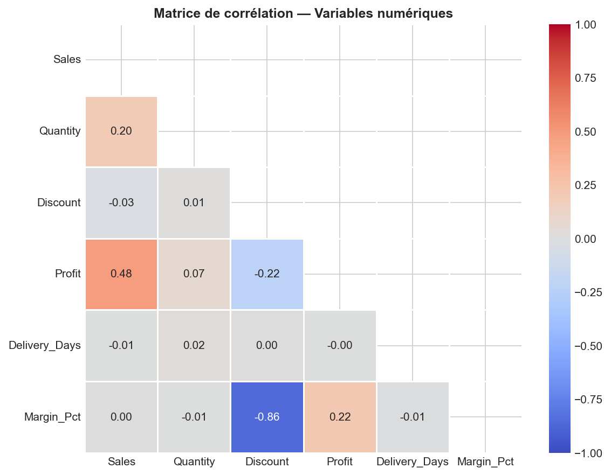

# Analyse des performances commerciales — Python

> **Outils** : Python (pandas, matplotlib, seaborn, scipy) 
> **Durée** : ~4 heures

---

## Problématique métier

Un magasin retail (Superstore) souhaite **analyser ses performances commerciales** sur 4 ans (2014-2017) pour comprendre quels produits, régions et segments sont les plus rentables, et identifier les **sous-catégories déficitaires** et l'**impact des remises** sur la rentabilité.

> *« Quels produits font perdre de l'argent ? Les remises sont-elles rentables ? Quelles régions sous-performent ? »*

---

## Objectifs du projet

- Explorer et nettoyer le dataset Superstore avec **pandas**
- Calculer les **KPI commerciaux** (CA, profit, marge, panier moyen)
- Créer **6 visualisations** (barplots, line charts, scatter, heatmap)
- Analyser l'**impact des remises** sur la rentabilité par palier
- Identifier les **sous-catégories déficitaires** (Top & Flop)
- Tester les **corrélations statistiques** avec Pearson (scipy)

---

## Outils & compétences mobilisées

| Compétence | Détail |
|---|---|
| **pandas** | Chargement, nettoyage, agrégation, feature engineering |
| **matplotlib** | Graphiques multi-axes, double Y-axis, formatting |
| **seaborn** | Heatmaps, palettes couleur, corrélation |
| **scipy** | Tests de corrélation de Pearson (r, p-value) |
| **Analyse business** | KPI, marge, impact remises, segmentation |

---

## Le dataset

**Source** : [Superstore Dataset (Kaggle)](https://www.kaggle.com/datasets/vivek468/superstore-dataset-final)

| Caractéristique | Détail |
|---|---|
| Lignes | 9 994 commandes |
| Colonnes | 21 variables |
| Période | 2014 — 2017 (4 ans) |
| Catégories | 3 (Furniture, Office Supplies, Technology) |
| Régions | 4 (Central, East, South, West) |
| Segments | 3 (Consumer, Corporate, Home Office) |
| Valeurs manquantes | 0 |
| Doublons | 0 |

---

## Méthodologie

### 1. Nettoyage des données

- **0 valeur manquante** détectée 
- **0 doublon** détecté 
- Conversion des dates (`Order Date`, `Ship Date`)
- Feature engineering : `Delivery_Days`, `Margin_Pct`, `Year`, `Month`
- Dataset final : **9 994 lignes × 27 colonnes**

### 2. KPI commerciaux

| KPI | Valeur |
|---|---|
| CA Total | $2 297 201 |
| Profit Total | $286 397 |
| Marge globale | 12,5% |
| Nb commandes | 5 009 |
| Panier moyen | $458,61 |
| Remise moyenne | 15,6% |
| Délai livraison moyen | 4,0 jours |

### 3. Analyse de corrélation (Pearson)

| Variable | r (Pearson) | p-value | Significatif |
|---|---|---|---|
| Sales ~ Profit | +0,479 | 0,0000 | oui |
| Quantity ~ Profit | +0,066 | 0,0000 | oui |
| Discount ~ Profit | -0,219 | 0,0000 | oui |
| Delivery_Days ~ Profit | -0,005 | 0,6421 | non |

---

## Visualisations



> Performance par Catégorie — Technology domine en CA ($836K) et en profit ($145K). Furniture génère un CA comparable ($742K) mais un profit très faible ($18K), révélant un problème de marge sur cette catégorie.



> Évolution mensuelle (2014-2017) — Le CA et le profit suivent une tendance haussière avec une forte saisonnalité : pics en fin d'année (novembre-décembre) et creux en janvier-février. Le profit ne suit pas toujours le CA, indiquant des périodes de fortes remises.



> Impact des Remises — Le scatter plot montre que les remises > 20% génèrent systématiquement des pertes. Le profit moyen par palier confirme : 0-10% = rentable ($65), 10-20% = légèrement rentable, 20%+ = déficitaire. Les remises > 30% détruisent la marge (-$160 en moyenne).



> Top & Flop Sous-catégories — Top 5 gains : Copiers ($56K), Phones ($44K), Accessories ($42K), Paper ($34K), Binders ($30K). Flop 5 pertes : Tables (-$18K), Bookcases (-$3K), Supplies (-$1K), Fasteners et Machines en légère perte.



> Profit Région × Catégorie — West est la région la plus rentable ($108K), portée par Office Supplies ($53K) et Technology ($44K). Central a un profit négatif en Furniture (-$2,9K). East performe en Technology ($47K).



> Matrice de corrélation — Corrélation forte entre Discount et Margin_Pct (r = -0,86) : les remises détruisent la marge. Sales ↔ Profit : corrélation positive modérée (r = 0,48). Delivery_Days n'a aucun impact sur le profit.

---

## Principaux insights business

### Performance globale
- CA total de **$2,3M** avec un profit de **$286K** (marge 12,5%)
- **Technology** est la catégorie la plus rentable (marge 15,6%)
- **Furniture** a un CA élevé mais un profit quasi nul (marge 3,9%)

### Sous-catégories déficitaires
- **Tables** : -$17 725 de pertes (remise moyenne 26%, marge -14,8%)
- **Bookcases** : -$3 473 de pertes (remise moyenne 21%)
- **Supplies** : -$1 189 de pertes
- Pertes totales : **-$22 387** sur ces 3 sous-catégories

### Impact des remises
- Remises **0-10%** : rentables (profit moyen +$65)
- Remises **10-20%** : légèrement rentables
- Remises **> 20%** : systématiquement déficitaires
- Corrélation Discount ↔ Margin_Pct : **r = -0,86** (très forte)

### Performance régionale
- **West** : meilleure région ($108K profit, marge 22%)
- **Central** : marge négative sur Furniture (-$2 871)
- **East** : performante en Technology ($47K)

---

## Recommandations

1. ** Plafonner les remises à 20%** : au-delà, chaque vente détruit de la marge
2. **Revoir la politique tarifaire Tables & Bookcases** : ces sous-catégories perdent de l'argent malgré un CA significatif
3. **Booster Technology en Central** : région sous-exploitée pour la catégorie la plus rentable
4. **Surveiller les commandes Discount > 30%** : mettre en place des alertes automatiques

---

## Compétences démontrées

- Exploration de données structurée et reproductible
- Feature engineering (Delivery_Days, Margin_Pct, paliers de remise)
- 6 visualisations variées et pertinentes
- Tests statistiques de corrélation (Pearson, p-values)
- Analyse Top & Flop avec identification des sous-catégories déficitaires
- Analyse croisée multi-dimensionnelle (Région × Catégorie)
- Interprétation business des résultats statistiques
- Recommandations actionnables basées sur les données

---

## Structure du projet

```
04-sales-performance-python/
├── dataset/
│ └── superstore.csv
├── notebooks/
│ └── 04_sales_performance.ipynb
├── images/
│ ├── 01_performance_categorie.png
│ ├── 02_evolution_temporelle.png
│ ├── 03_impact_remises.png
│ ├── 04_top_flop_souscategories.png
│ ├── 05_heatmap_region_categorie.png
│ └── 06_correlation.png
├── reports/
└── README.md
```

---

## Pour reproduire ce projet

```bash
# 1. Cloner le repo
git clone https://github.com/barde44/portfolio-data-analyst.git
cd portfolio-data-analyst/04-sales-performance-python

# 2. Installer les dépendances
pip install pandas numpy matplotlib seaborn scipy jupyter

# 3. Lancer le notebook
jupyter notebook notebooks/04_sales_performance.ipynb
```

---

## À propos

**Portfolio complet** : [github.com/barde44/portfolio-data-analyst](https://github.com/barde44/portfolio-data-analyst)
