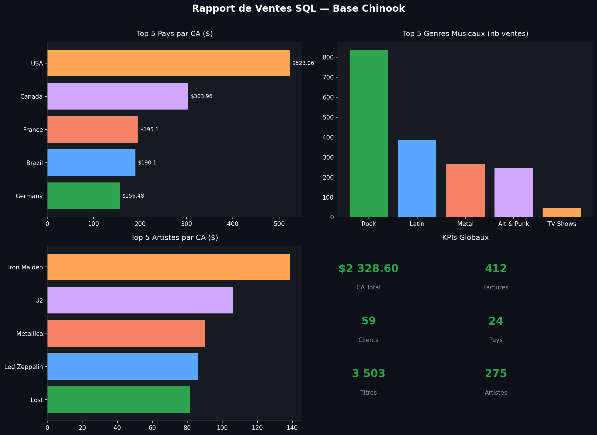
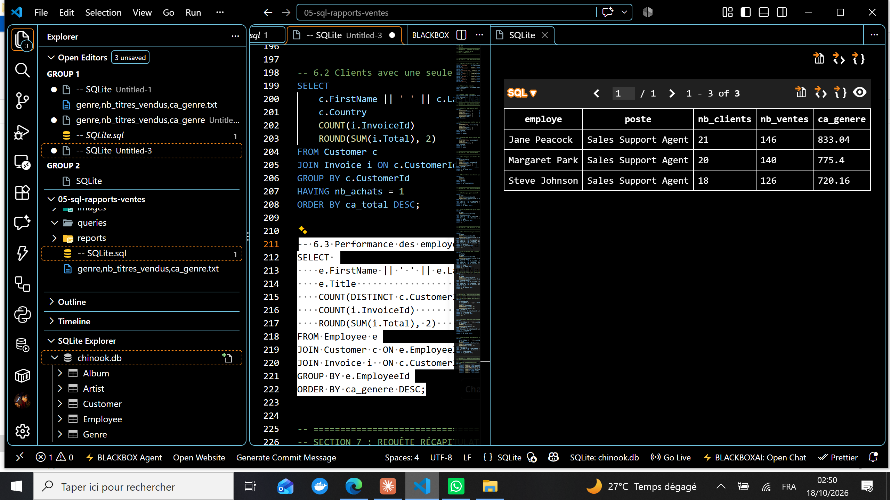

# Rapports de ventes SQL — Base Chinook

> **Outils** : SQL (SQLite), Python (matplotlib) 
> **Durée** : ~3 heures

---

## Problématique métier

Un magasin de musique numérique souhaite **analyser ses ventes** à partir de sa base de données relationnelle (Chinook) pour comprendre quels pays, genres musicaux et artistes génèrent le plus de revenus, et évaluer la **performance des agents de vente**.

> *« Quels pays génèrent le plus de revenus ? Quels genres musicaux dominent ? Quels artistes sont les plus rentables ? »*

---

## Objectifs du projet

- Explorer la base Chinook avec des **requêtes SQL structurées**
- Calculer les **KPIs globaux** (CA, factures, panier moyen)
- Analyser les ventes par **pays**, **genre musical** et **artiste**
- Identifier les **top clients** et évaluer la **performance des employés**
- Produire un **dashboard récapitulatif** avec matplotlib

---

## Outils & compétences mobilisées

| Compétence | Détail |
|---|---|
| **SQL (SQLite)** | SELECT, JOIN, GROUP BY, HAVING, sous-requêtes, UNION ALL |
| **Agrégation** | SUM, COUNT, AVG, MIN, MAX, ROUND, COUNT(DISTINCT) |
| **Jointures** | Multi-tables (4 JOINs : InvoiceLine → Track → Album → Artist) |
| **Fonctions date** | STRFTIME pour extraction année/mois |
| **Python** | matplotlib pour dashboard de synthèse |
| **Analyse business** | KPIs, segmentation pays/genre, performance employés |

---

## La base de données

**Source** : [Chinook Database](https://github.com/lerocha/chinook-database) (magasin de musique numérique)

| Table | Nb lignes | Description |
|---|---|---|
| Customer | 59 | Clients répartis dans 24 pays |
| Invoice | 412 | Factures de vente |
| InvoiceLine | 2 240 | Détail des lignes de facture |
| Track | 3 503 | Titres musicaux |
| Artist | 275 | Artistes |
| Album | 347 | Albums |
| Genre | 25 | Genres musicaux |

---

## Méthodologie

### 1. Exploration de la base

- **7 tables principales** explorées
- Structure relationnelle : Customer → Invoice → InvoiceLine → Track → Album → Artist
- **0 valeur manquante** dans les tables principales 

### 2. KPI globaux

| KPI | Valeur |
|---|---|
| CA Total | $2 328,60 |
| Nb factures | 412 |
| Panier moyen | $5,65 |
| Facture min | $0,99 |
| Facture max | $25,86 |
| Nb clients | 59 |
| Nb pays | 24 |

### 3. Requêtes SQL (7 sections)

1. **Exploration** : comptage par table, aperçu clients et factures
2. **Ventes globales** : CA total, évolution annuelle et mensuelle
3. **Analyse par pays** : Top 10 pays, répartition clients
4. **Genres musicaux** : ventes par genre, top 5 genres
5. **Artistes & albums** : top 10 artistes, albums, titres
6. **Analyse clients** : top 10 clients, clients à risque de churn, performance employés
7. **Vue synthèse** : KPIs récapitulatifs en une requête

---

## Visualisations



> Dashboard récapitulatif — Vue synthèse des KPIs globaux, top 5 pays par CA (USA $523, Canada $304, France $195), top 5 genres musicaux (Rock 835 ventes, Latin 386, Metal 264), et top 5 artistes par CA (Iron Maiden $139, U2 $106, Metallica $90).

.png)

> KPIs globaux — Résultat de la requête SQL : CA total $2 328,60, 412 factures, panier moyen $5,65, facture min $0,99, facture max $25,86.


> Top 10 pays par CA — USA domine avec $523,06 (91 factures, 13 clients). Canada 2e avec $303,96. France et Brazil suivent autour de $190-195.


> Ventes par genre — 24 genres analysés. Rock écrase la concurrence (835 ventes, $826,65). Latin (386, $382,14), Metal (264, $261,36) et Alternative & Punk (244, $241,56) complètent le podium.


> Top 10 artistes par CA — Iron Maiden domine ($138,60, 140 titres vendus), suivi de U2 ($105,93), Metallica ($90,09), Led Zeppelin ($86,13) et Lost ($81,59).


> Top 10 clients par CA — Helena Holý (Czech Republic, $49,62) est la meilleure cliente. Tous les top clients ont exactement 7 achats, avec un panier moyen entre $6,09 et $7,09.



> Performance des employés — 3 agents de vente : Jane Peacock ($833,04, 21 clients), Margaret Park ($775,40, 20 clients), Steve Johnson ($720,16, 18 clients). Performance relativement homogène.

---

## Principaux insights business

### Performance globale
- CA total de **$2 328,60** sur 412 factures
- **Panier moyen faible** ($5,65) → typique du digital (achat à l'unité)
- **59 clients** répartis dans **24 pays**

### Analyse géographique
- **USA** domine avec $523,06 (22,5% du CA total, 13 clients)
- **Top 5 pays** = 59% du CA total (USA, Canada, France, Brazil, Germany)
- Forte concentration géographique des revenus

### Genres musicaux
- **Rock** = 36% des ventes (835 titres sur 2 240)
- **Top 4 genres** (Rock, Latin, Metal, Alt & Punk) = 79% des ventes
- **TV Shows** en 5e position par CA ($93,53) malgré seulement 47 ventes (prix unitaire élevé)

### Clients
- Tous les top clients ont **7 achats** → possible plafond lié au système
- Panier moyen très homogène ($6-$7)
- Pas de client vraiment dominant → base client diversifiée

---

## Recommandations

1. **Renforcer le marché US** : 22,5% du CA mais potentiel de croissance (13 clients seulement)
2. **Capitaliser sur le Rock** : 36% des ventes, développer le catalogue Rock/Metal
3. **Augmenter le panier moyen** : bundles, promotions sur albums complets vs titres individuels
4. **Développer les marchés européens** : France, Germany, UK ont un bon potentiel
5. **Analyser les TV Shows** : CA/vente élevé ($1,99 vs $0,99) → pousser ce format

---

## Compétences démontrées

- Requêtes SQL complexes avec jointures multi-tables (4 JOINs)
- Agrégations avancées (GROUP BY, HAVING, sous-requêtes)
- Fonctions de date SQLite (STRFTIME)
- Analyse de base de données relationnelle (7 tables)
- Dashboard de synthèse avec matplotlib
- Segmentation business (pays, genre, artiste, client)
- Interprétation business et recommandations actionnables

---

## Structure du projet

```
05-sql-rapports-ventes/
├── dataset/
│ └── chinook.db
├── queries/
│ └── -- SQLite.sql
├── images/
│ ├── 00_dashboard_sql.png
│ ├── KPIs globaux (ca_total, nb_factures, panier_moyen).png
│ ├── Top 10 pays.png
│ ├── Ventes par genre.png
│ ├── Top 10 artistes.png
│ ├── Top 10 clients.png
│ └── performance_employes.png.png
├── reports/
│ └── generate_chart.py
├── -- SQLite.sql
└── README.md
```

---

## Pour reproduire ce projet

```bash
# 1. Cloner le repo
git clone https://github.com/barde44/portfolio-data-analyst.git
cd portfolio-data-analyst/05-sql-rapports-ventes

# 2. Ouvrir dans VS Code avec l'extension SQLite
code .

# 3. Exécuter les requêtes sur chinook.db
# Utiliser l'extension SQLite Explorer dans VS Code
```

---

## À propos

**Portfolio complet** : [github.com/barde44/portfolio-data-analyst](https://github.com/barde44/portfolio-data-analyst)
