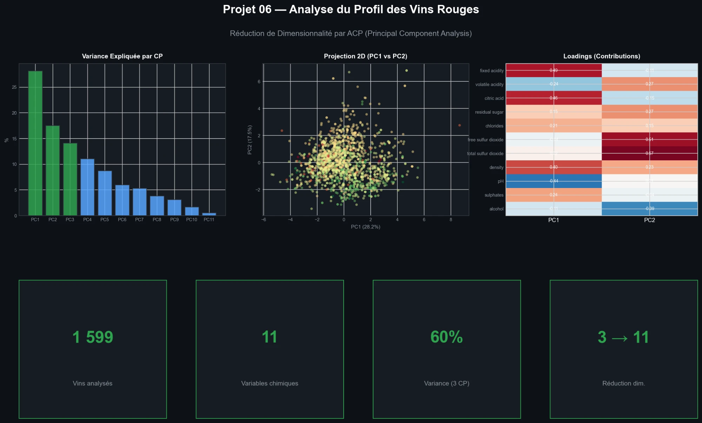
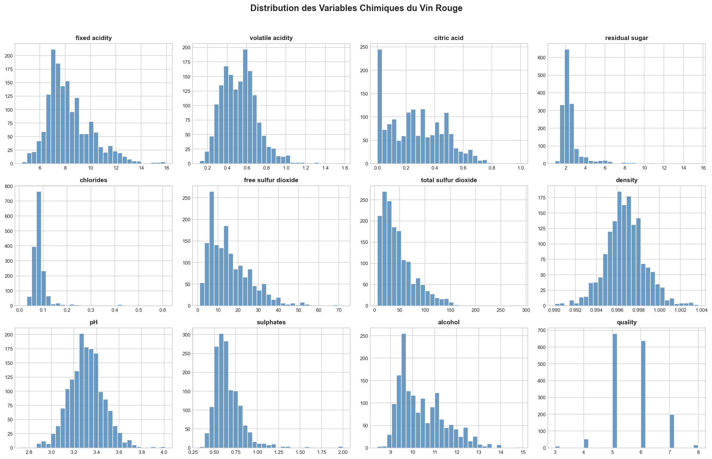
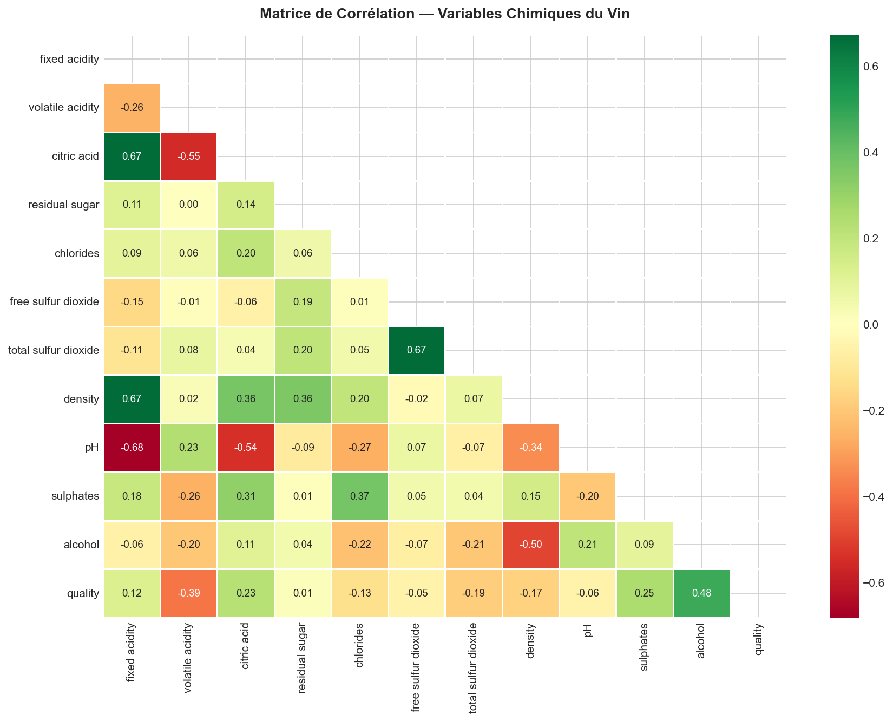
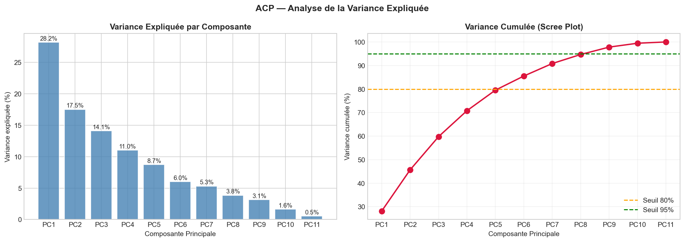
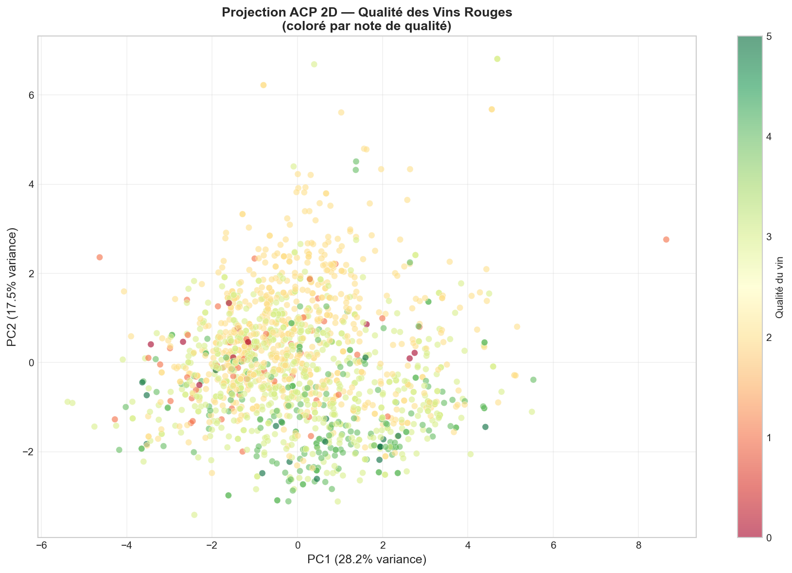
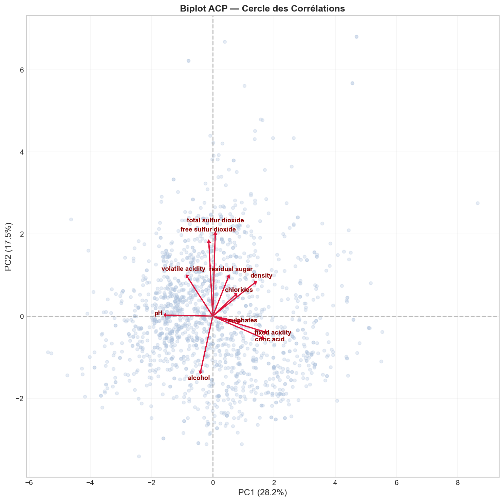
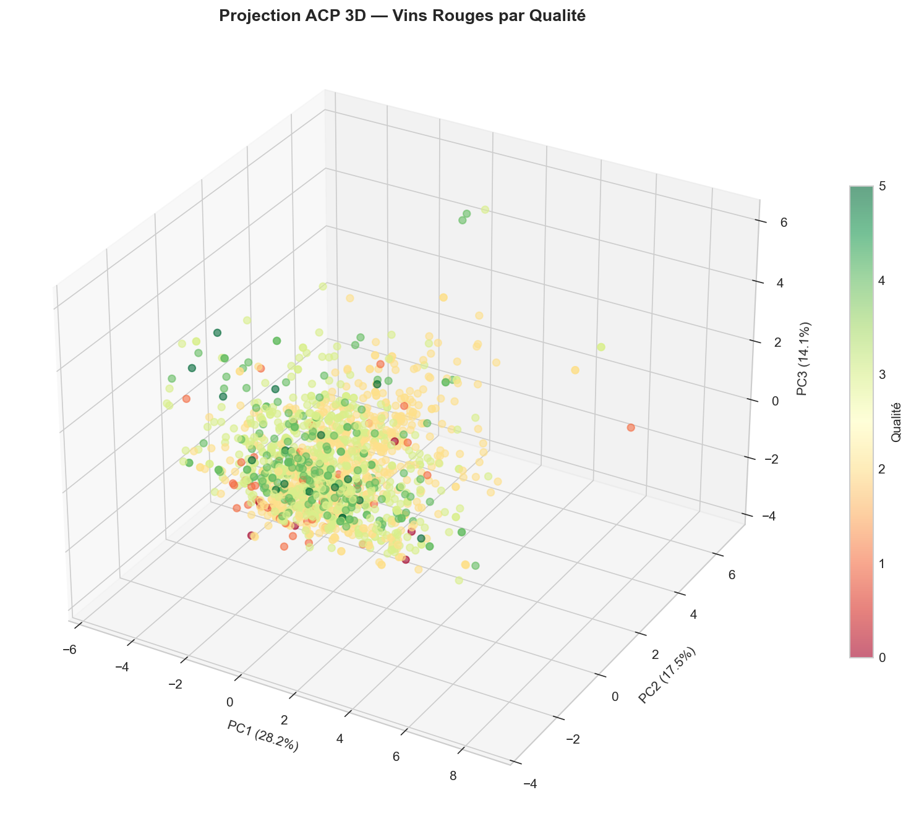
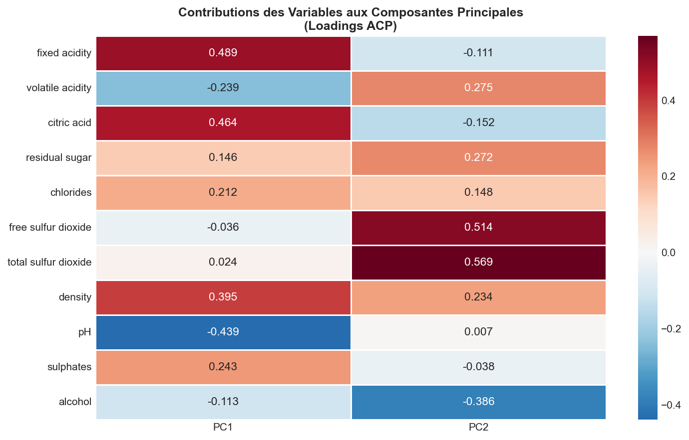

# Analyse du Profil des Vins — ACP (Analyse en Composantes Principales)

> **Outils** : Python (pandas, numpy, matplotlib, seaborn, scikit-learn)  
> **Durée** : ~3 heures

---

## Problematique metier

Un producteur de vin rouge souhaite **comprendre les facteurs chimiques** qui influencent la qualite de ses vins. Avec **11 variables chimiques** mesurees sur 1 599 echantillons, il est difficile d'identifier visuellement les axes de differenciation. L'**Analyse en Composantes Principales (ACP)** permet de reduire cette complexite pour reveler les profils chimiques determinants.

> *« Quelles variables chimiques distinguent un vin de haute qualite ? Peut-on reduire 11 dimensions en 2-3 axes interpretables ? »*

---

## Objectifs du projet

- Analyser les **distributions** et **correlations** des 11 variables chimiques
- **Standardiser** les donnees (obligatoire pour l'ACP)
- Appliquer l'**ACP** pour identifier les composantes principales
- Visualiser les projections en **2D et 3D** colorees par qualite
- Interpreter les **loadings** et le **cercle des correlations** (biplot)
- Identifier les **profils chimiques** des vins de haute vs basse qualite

---

## Outils & competences mobilisees

| Competence | Detail |
|---|---|
| **Python (pandas, numpy)** | Chargement, exploration, statistiques descriptives |
| **scikit-learn** | StandardScaler, PCA (decomposition) |
| **matplotlib / seaborn** | Histogrammes, heatmaps, scatter 2D/3D, biplot |
| **Analyse multivariee** | ACP, variance expliquee, scree plot, loadings |
| **Interpretation statistique** | Cercle des correlations, axes discriminants |

---

## Le dataset

**Source** : [Wine Quality Dataset — UCI ML Repository](https://archive.ics.uci.edu/dataset/186/wine+quality) (vin rouge)

| Variable | Description |
|---|---|
| fixed acidity | Acidite fixe (g/L) |
| volatile acidity | Acidite volatile (g/L) |
| citric acid | Acide citrique (g/L) |
| residual sugar | Sucre residuel (g/L) |
| chlorides | Chlorures (g/L) |
| free sulfur dioxide | SO2 libre (mg/L) |
| total sulfur dioxide | SO2 total (mg/L) |
| density | Densite |
| pH | pH |
| sulphates | Sulfates (g/L) |
| alcohol | Alcool (% vol.) |
| quality | Note de qualite (3 a 8) |

- **1 599 echantillons** de vin rouge
- **11 variables chimiques** + 1 variable cible (quality)
- **0 valeur manquante**

---

## Methodologie

### 1. Exploration des donnees

- **1 599 vins rouges**, 12 colonnes
- Distribution de la qualite : 82.6% des vins notes 5 ou 6
- **0 valeur manquante**

### 2. Matrice de correlation

- Correlations notables : fixed acidity / citric acid (+0.67), fixed acidity / density (+0.67), alcohol / density (-0.50)
- Multicolinearite detectee, justifiant l'approche ACP

### 3. Standardisation et ACP

- StandardScaler applique (moyenne = 0, ecart-type = 1)
- ACP complete sur les 11 composantes

### 4. Variance expliquee

| Composante | Variance | Cumulee |
|---|---|---|
| PC1 | 28.2% | 28.2% |
| PC2 | 17.5% | 45.7% |
| PC3 | 14.1% | 59.8% |
| PC4 | 11.0% | 70.8% |
| PC5 | 8.7% | 79.5% |
| PC6 | 6.0% | 85.5% |
| PC7 | 5.3% | 90.8% |

- **3 composantes** = ~60% de la variance
- **7 composantes** = 95% de la variance (seuil Kaiser)

---

## Visualisations



> Dashboard récapitulatif — Variance expliquée par composante (PC1 = 28,2%), projection 2D des vins (PC1 vs PC2) colorée par qualité, heatmap des loadings (contributions des variables), et KPIs clés : 1 599 vins analysés, 11 variables chimiques, 60% de variance capturée en 3 composantes.



> Distribution des 12 variables du dataset. La majorite des variables presentent des distributions asymetriques a droite, avec des outliers importants (chlorides, residual sugar, total sulfur dioxide).



> Matrice de correlation (triangle inferieur). Correlations fortes : fixed acidity / citric acid (+0.67), fixed acidity / density (+0.67), free SO2 / total SO2 (+0.67). Anti-correlation : alcohol / density (-0.50).



> Variance expliquee par composante (barres) et variance cumulee avec scree plot. PC1 capture 28.2%, les 3 premieres composantes = 59.8%. Le seuil de 80% est atteint a PC5, le seuil de 95% a PC7.



> Projection 2D des vins sur PC1 (28.2%) et PC2 (17.5%), coloree par note de qualite (vert = haute, rouge = basse). Les vins de haute qualite tendent vers les valeurs positives de PC1.



> Biplot ACP avec vecteurs des variables originales. L'alcool et les sulfates pointent vers la droite (PC1+), l'acidite volatile et le SO2 total vers la gauche. Le cercle des correlations revele les groupes de variables correles.



> Projection 3D sur les 3 premieres composantes (59.8% de la variance totale). La troisieme dimension (PC3 = 14.1%) ajoute la separation par chlorides et acidite volatile.



> Heatmap des loadings (contributions des variables aux composantes). PC1 : dominee par total sulfur dioxide, free sulfur dioxide (negatif) et sulphates, fixed acidity (positif). PC2 : dominee par residual sugar et free SO2 (positif).

---

## Principaux insights

### Axes discriminants identifies

| Composante | Variables dominantes | Interpretation |
|---|---|---|
| PC1 (28.2%) | Acides, densite, alcool | Profil chimique global |
| PC2 (17.5%) | SO2 libre/total, sucre residuel | Conservation et douceur |
| PC3 (14.1%) | Chlorides, acidite volatile | Defauts potentiels |

### Profil des vins de qualite

- Les vins de **haute qualite (7-8)** se distinguent par un alcool eleve et une acidite volatile faible
- Les vins de **basse qualite (3-4)** ont une acidite volatile plus elevee (defaut organoleptique)
- L'ACP confirme que l'**alcool** et l'**acidite volatile** sont les meilleurs predicteurs de la qualite

### Reduction dimensionnelle

- 11 variables reduites a **3 composantes** sans perte majeure d'information (~60%)
- Le scree plot montre un "coude" net apres PC3
- L'ACP permet une visualisation interpretable d'un espace a 11 dimensions

---

## Recommandations

1. **Privilegier l'alcool et l'acidite volatile** comme indicateurs rapides de qualite
2. **Utiliser 3 composantes** pour tout modele predictif (reduction de 73% des features)
3. **Surveiller les chlorides** (PC3) comme marqueur de defauts potentiels
4. **Explorer un clustering** (K-Means sur les composantes) pour segmenter les profils de vins

---

## Competences demontrees

- Analyse en Composantes Principales (ACP) avec scikit-learn
- Standardisation et preprocessing pour analyse multivariee
- Visualisation 2D et 3D de projections ACP
- Interpretation de biplot et cercle des correlations
- Analyse des loadings et contributions des variables
- Reduction dimensionnelle et interpretation business

---

## Structure du projet

```
06-wine-quality-acp/
├── dataset/
│   └── winequality-red.csv
├── notebooks/
│   └── 06_wine_quality_acp.ipynb
├── images/
│   ├── 00_dashboard.webp
│   ├── 01_distributions.png
│   ├── 02_correlation.png
│   ├── 03_variance_acp.png
│   ├── 04_acp_2d.png
│   ├── 05_biplot.png
│   ├── 06_acp_3d.png
│   └── 07_loadings.png
└── README.md
```

---

## Pour reproduire ce projet

```bash
# 1. Cloner le repo
git clone https://github.com/barde44/portfolio-data-analyst.git
cd portfolio-data-analyst/06-wine-quality-acp

# 2. Installer les dependances
pip install pandas numpy matplotlib seaborn scikit-learn

# 3. Lancer le notebook
jupyter notebook notebooks/06_wine_quality_acp.ipynb
```

---

## A propos

Portfolio complet : [github.com/barde44/portfolio-data-analyst](https://github.com/barde44/portfolio-data-analyst)
