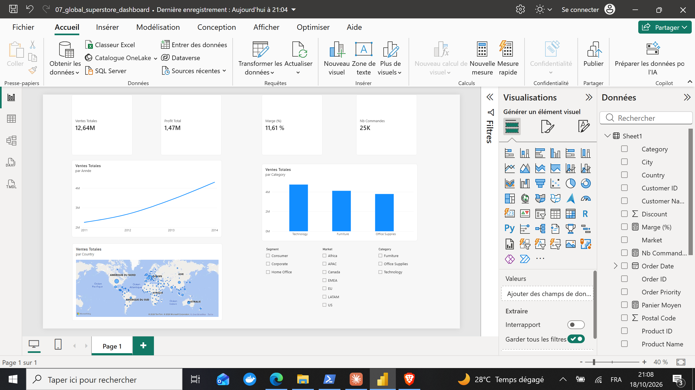

# Dashboard Power BI — Global Superstore

> **Outils** : Power BI Desktop, DAX, Power Query  
> **Durée** : ~4 heures

---

## Problematique metier

Une entreprise de distribution mondiale (Global Superstore) souhaite **suivre ses performances commerciales** sur l'ensemble de ses marches internationaux. Avec plus de **25 000 commandes** reparties dans **7 marches** et **3 segments clients**, la direction a besoin d'un **tableau de bord interactif** pour piloter les ventes, la rentabilite et la repartition geographique du chiffre d'affaires.

> *« Comment se repartissent nos $12,64M de ventes entre marches, categories et periodes ? Quels leviers activer pour ameliorer la marge de 11,61% ? »*

---

## Objectifs du projet

- Construire un **dashboard interactif** dans Power BI Desktop
- Calculer et afficher les **KPIs cles** (CA, profit, marge, nombre de commandes)
- Visualiser l'**evolution temporelle** des ventes (2011-2014)
- Analyser les ventes par **categorie de produit** et par **pays**
- Implementer des **filtres interactifs** (Segment, Market, Category)
- Permettre une exploration dynamique des donnees par les decideurs

---

## Outils & competences mobilisees

| Competence | Detail |
|---|---|
| **Power BI Desktop** | Modelisation, visualisation, mise en page du rapport |
| **Power Query** | Chargement et transformation des donnees Excel |
| **DAX** | Mesures calculees (CA, Profit, Marge %, Panier moyen) |
| **Visualisations** | Cartes KPI, line chart, bar chart, carte geographique |
| **Filtres interactifs** | Slicers Segment, Market, Category avec cross-filtering |
| **Analyse business** | KPIs commerciaux, analyse multi-dimensionnelle |

---

## Le dataset

**Source** : Global Superstore (dataset de distribution mondiale)

| Champ | Description |
|---|---|
| Order Date | Date de commande (2011-2014) |
| Segment | Consumer, Corporate, Home Office |
| Market | Africa, APAC, Canada, EMEA, EU, LATAM, US |
| Category | Technology, Furniture, Office Supplies |
| Country | Pays du client |
| Sales | Montant de la vente |
| Profit | Profit genere |
| Discount | Remise appliquee |
| Quantity | Quantite commandee |

- **25 000+ commandes** sur 4 ans (2011-2014)
- **7 marches** internationaux
- **3 segments** clients
- **3 categories** de produits

---

## Le dashboard



> Dashboard interactif Power BI avec 4 KPIs en haut (Ventes Totales : 12,64M, Profit Total : 1,47M, Marge : 11,61%, Nb Commandes : 25K), evolution des ventes par annee (2011-2014), ventes par categorie (Technology > Furniture > Office Supplies), carte geographique des ventes par pays, et filtres interactifs (Segment, Market, Category).

---

## KPIs principaux

| KPI | Valeur |
|---|---|
| Ventes Totales | $12,64M |
| Profit Total | $1,47M |
| Marge (%) | 11,61% |
| Nb Commandes | 25K |

---

## Principaux insights

### Performance globale

- CA total de **$12,64M** avec un profit de **$1,47M** (marge de 11,61%)
- **25 000+ commandes** traitees sur la periode 2011-2014
- Croissance continue des ventes : de ~$2M en 2011 a ~$4,5M en 2014

### Analyse par categorie

- **Technology** en tete des ventes (~$4,7M), suivie par Furniture (~$4,1M) et Office Supplies (~$3,8M)
- Les trois categories ont des volumes comparables, avec Technology legerement en avance

### Repartition geographique

- Distribution mondiale avec presence sur **7 marches**
- Forte concentration en Amerique du Nord, Europe et APAC
- L'Afrique et le LATAM representent des marches emergents avec des volumes plus faibles

### Evolution temporelle

- Tendance haussiere constante sur 4 ans
- Acceleration notable entre 2013 et 2014
- Saisonnalite potentielle a explorer avec des filtres temporels plus fins

---

## Recommandations

1. **Approfondir l'analyse Technology** : categorie leader, explorer les sous-categories les plus rentables
2. **Optimiser la marge** (11,61%) : identifier les produits/marches a marge negative
3. **Developper les marches emergents** : LATAM et Afrique montrent un potentiel de croissance
4. **Analyser l'impact des remises** : les discounts excessifs pourraient expliquer la marge moderee
5. **Ajouter des KPIs avances** : panier moyen, taux de retour, profit par segment

---

## Competences demontrees

- Construction de dashboard interactif dans Power BI Desktop
- Modelisation de donnees et creation de mesures DAX
- Transformation de donnees avec Power Query
- Design de visualisations (KPI cards, line chart, bar chart, carte geographique)
- Implementation de filtres cross-filtering (Segment, Market, Category)
- Analyse business multi-dimensionnelle et storytelling data

---

## Structure du projet

```
07-dashboard-powerbi/
├── dataset/
│   └── Global_Superstore2.xlsx
├── report/
│   └── 07_global_superstore_dashboard.pbix
├── images/
│   └── 07-dashboard-powerbiimages00_dashboard_powerbi.png
└── README.md
```

---

## Pour reproduire ce projet

```
1. Telecharger Power BI Desktop (gratuit)
2. Ouvrir le fichier report/07_global_superstore_dashboard.pbix
3. Les donnees sont embarquees dans le fichier .pbix
4. Utiliser les slicers pour explorer les donnees par Segment, Market et Category
```

---

## A propos

Portfolio complet : [github.com/barde44/portfolio-data-analyst](https://github.com/barde44/portfolio-data-analyst)
