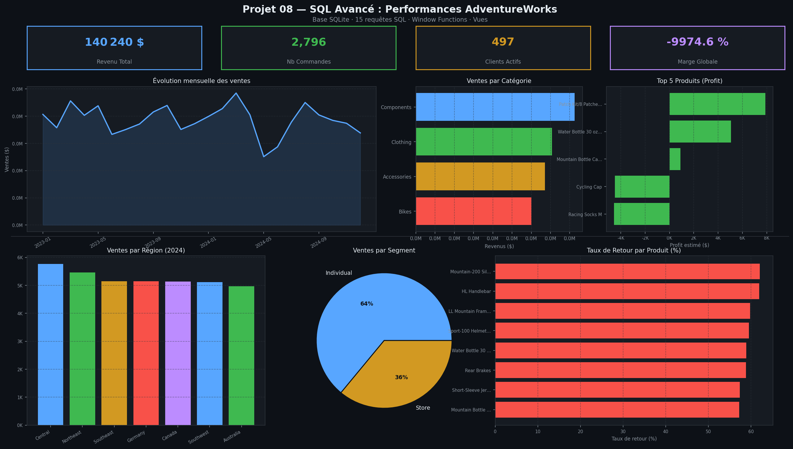

# SQL Avance — Performances AdventureWorks

> **Outils** : SQL, SQLite, Python (pandas, matplotlib, seaborn)  
> **Duree** : ~6 heures

---

## Problematique metier

Une entreprise manufacturiere (AdventureWorks) souhaite **analyser ses performances commerciales** sur la periode 2022-2024. Avec **3 000 commandes**, **500 clients** repartis dans **9 regions** et **30 produits** dans **4 categories**, la direction a besoin de requetes SQL avancees pour extraire des insights strategiques sur les ventes, la rentabilite et le comportement client.

> *« Quels produits, regions et segments generent le plus de revenus ? Quels leviers activer pour ameliorer la marge globale ? »*

---

## Objectifs du projet

- Creer une base de donnees relationnelle SQLite avec **9 tables** normalisees
- Rediger **15 requetes SQL** avancees (jointures, agregations, window functions, sous-requetes, CASE WHEN)
- Creer **3 vues SQL** pour automatiser les rapports KPI
- Analyser les ventes par region, categorie, agent, segment et produit
- Construire un dashboard de synthese Python avec 6 graphiques et 4 KPIs

---

## Outils & competences mobilisees

| Competence | Detail |
|---|---|
| **SQL avance** | JOIN complexes, GROUP BY, HAVING, sous-requetes imbriquees |
| **Window Functions** | RANK(), NTILE(), SUM() OVER (PARTITION BY ... ORDER BY ... ROWS BETWEEN) |
| **Vues SQL** | vue_kpi_global, vue_ventes_mensuelles, vue_top_clients |
| **CASE WHEN** | Segmentation clients par montant depense (Bas, Moyen, Eleve) |
| **SQLite** | Base de donnees relationnelle, 9 tables, cles etrangeres |
| **Python** | pandas, matplotlib, seaborn pour la visualisation du dashboard |

---

## Le dataset

**Source** : Base AdventureWorks recreee en SQLite (donnees synthetiques realistes)

| Table | Lignes | Description |
|---|---|---|
| Region | 9 | USA (5 regions), Canada, France, Germany, Australia |
| ProductCategory | 4 | Bikes, Components, Clothing, Accessories |
| ProductSubcategory | 12 | Mountain Bikes, Handlebars, Jerseys, Helmets... |
| Product | 30 | Produits avec ListPrice et StandardCost |
| SalesPerson | 15 | Agents commerciaux rattaches aux regions |
| Customer | 500 | Clients Individual (64%) et Store (36%) |
| SalesOrderHeader | 3 000 | Commandes 2022-2024, canaux Online/Store |
| SalesOrderDetail | 8 000 | Lignes de commande avec quantites et montants |
| SalesReturn | 200 | Retours produits avec quantites |

---

## Les 15 requetes SQL

### Section 1 — Requetes de base
1. **Ventes par region (2024)** : JOIN Region + agregation SUM/COUNT
2. **Clients actifs** : HAVING + MAX(OrderDate) pour detecter les clients recents
3. **Ventes par categorie** : JOIN 4 tables + agregation AVG (panier moyen)

### Section 2 — Agregations et relations
4. **Ventes par agent commercial** : LEFT JOIN + GROUP BY multi-tables
5. **Top 5 produits rentables** : Calcul de profit estime (ListPrice - StandardCost)
6. **Ventes par segment** : Window Function SUM() OVER() pour calculer les parts en %

### Section 3 — Analyse des segments
7. **Segmentation clients** : CASE WHEN + sous-requete pour classifier Bas/Moyen/Eleve
8. **Top 10 clients** : RANK() OVER (ORDER BY ...) pour le classement
9. **Clients Online vs Store** : MAX(CASE WHEN ...) pour pivoter les canaux

### Section 4 — Analyse par produit
10. **Produits populaires 2024** : Filtrage temporel + ORDER BY quantite
11. **Ventes par sous-categorie** : Granularite fine sur 12 sous-categories
12. **Ventes mensuelles cumulees** : SUM() OVER (PARTITION BY ... ROWS BETWEEN UNBOUNDED PRECEDING AND CURRENT ROW)

### Section 5 — Optimisation des ventes
13. **Ventes region x produit** : Croisement 2 dimensions pour identification des forces locales
14. **Taux de retour** : LEFT JOIN SalesReturn + COALESCE + NULLIF pour gerer les divisions par zero
15. **Rentabilite produits** : NTILE(4) pour quartiles de rentabilite + calcul de marge nette

---

## Vues SQL pour rapports automatises

| Vue | Description |
|---|---|
| **vue_kpi_global** | KPIs consolides : total commandes, clients, revenu, panier moyen, marge globale |
| **vue_ventes_mensuelles** | Ventes agregees par mois pour le suivi temporel |
| **vue_top_clients** | Classement RANK() des clients par revenu total |

---

## Visualisations



> Dashboard de synthese avec 4 KPIs (Revenu Total : 140 240 $, Nb Commandes : 2 796, Clients Actifs : 497, Marge Globale : -9 974,6%), evolution mensuelle des ventes 2023-2024, ventes par categorie, top 5 produits par profit, ventes par region 2024, segments clients (Individual 64% / Store 36%), et taux de retour par produit.

---

## Principaux insights

### KPIs globaux
- Revenu total de **140 240 $** sur 2 796 commandes (panier moyen : 17,53 $)
- **497 clients actifs** repartis dans 9 regions et 2 segments

### Analyse par categorie
- **Components** en tete (41 259 $), suivis par Clothing (35 408 $), Accessories (33 539 $) et Bikes (30 034 $)
- Les sous-categories Handlebars (17 232 $) et Bottles (14 232 $) dominent en revenus

### Segmentation clients
- **Individual** : 64% des ventes (318 clients, 1 797 commandes)
- **Store** : 36% des ventes (179 clients, 999 commandes)

### Analyse des retours
- Taux de retour eleves sur Mountain-200 Silver (62%) et HL Handlebar (62%)
- Indicateur de problemes de qualite ou d'adequation produit-client

### Performance regionale (2024)
- **Central** en tete (5 769 $), suivi par Northeast (5 459 $) et Southeast (5 152 $)
- Distribution relativement equilibree entre les 9 regions

---

## Recommandations

1. **Auditer les produits a fort taux de retour** : Mountain-200 Silver (62%) et HL Handlebar (62%) necessitent une analyse qualite
2. **Developper le segment Store** : 36% des ventes mais marge d'amelioration significative
3. **Optimiser la structure de prix** : ecart important entre ListPrice et StandardCost sur certains produits
4. **Renforcer les regions sous-performantes** : France et Northwest en retrait par rapport aux autres regions en 2024
5. **Automatiser le reporting** : les 3 vues SQL permettent un suivi en temps reel des KPIs

---

## Competences demontrees

- Conception de schema relationnel normalise (9 tables, cles etrangeres)
- Requetes SQL avancees : JOIN complexes, agregations multi-niveaux
- Window Functions : RANK(), NTILE(), SUM() OVER (PARTITION BY)
- Sous-requetes et CASE WHEN pour la segmentation
- Creation de vues SQL pour l'automatisation des rapports
- Visualisation de donnees avec Python (matplotlib, seaborn)

---

## Structure du projet

```
08-sql-adventureworks/
├── dataset/
│   └── adventureworks.db
├── images/
│   └── 00_dashboard_sql.png
├── notebooks/
│   └── 08_sql_adventureworks.ipynb
└── README.md
```

---

## Pour reproduire ce projet

```
1. Cloner le repository
2. Ouvrir le notebook notebooks/08_sql_adventureworks.ipynb
3. Executer toutes les cellules (la base SQLite est creee automatiquement)
4. Le dashboard est sauvegarde dans images/00_dashboard_sql.png
```

---

## A propos

Portfolio complet : [github.com/barde44/portfolio-data-analyst](https://github.com/barde44/portfolio-data-analyst)
