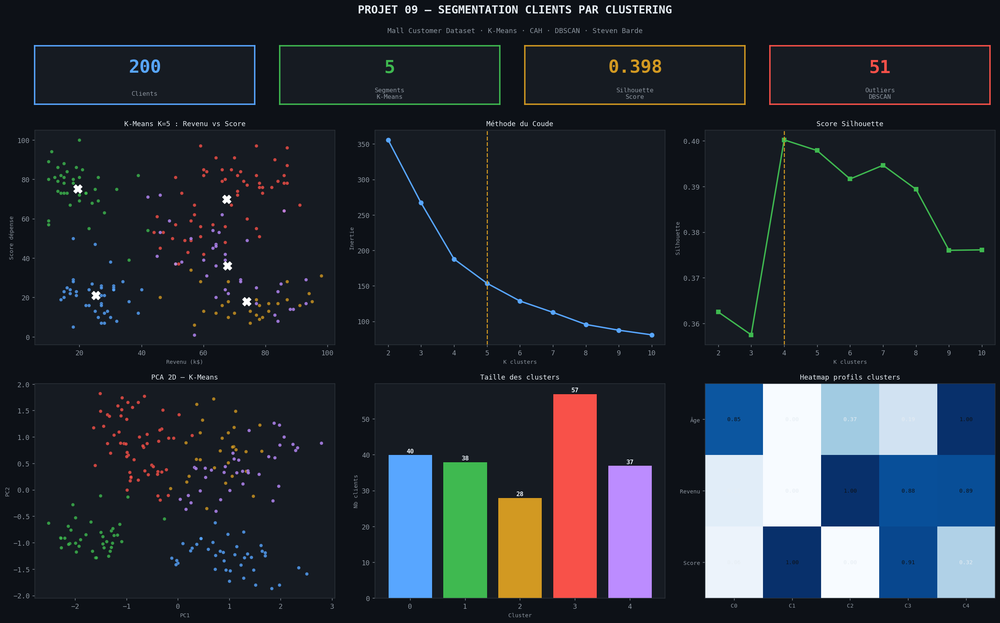
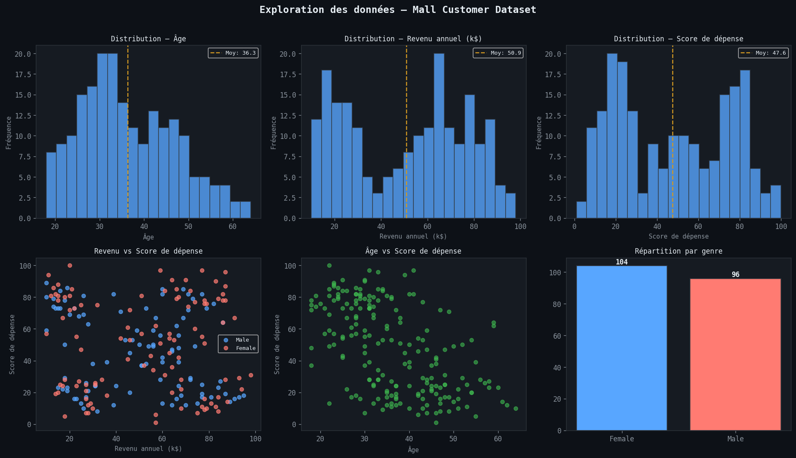
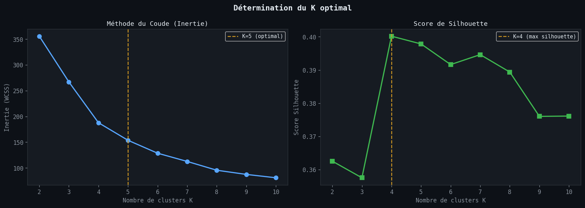
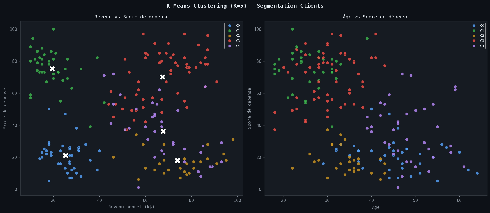
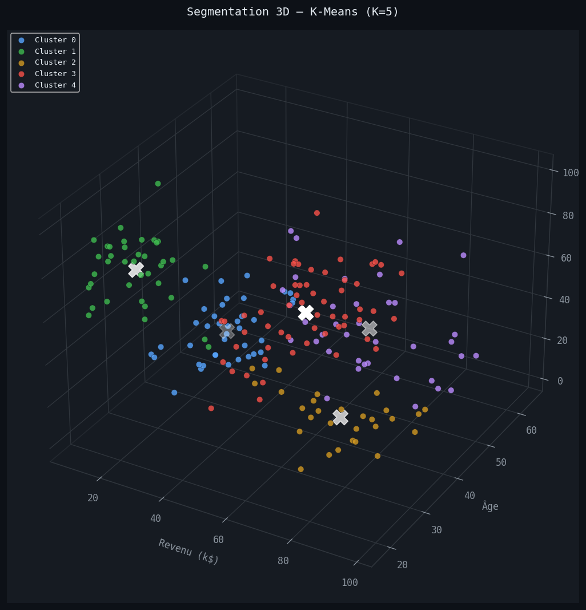
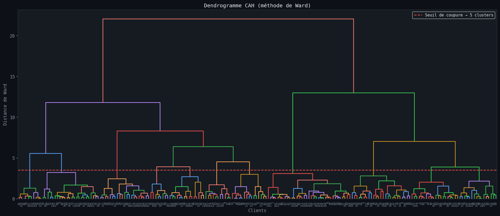
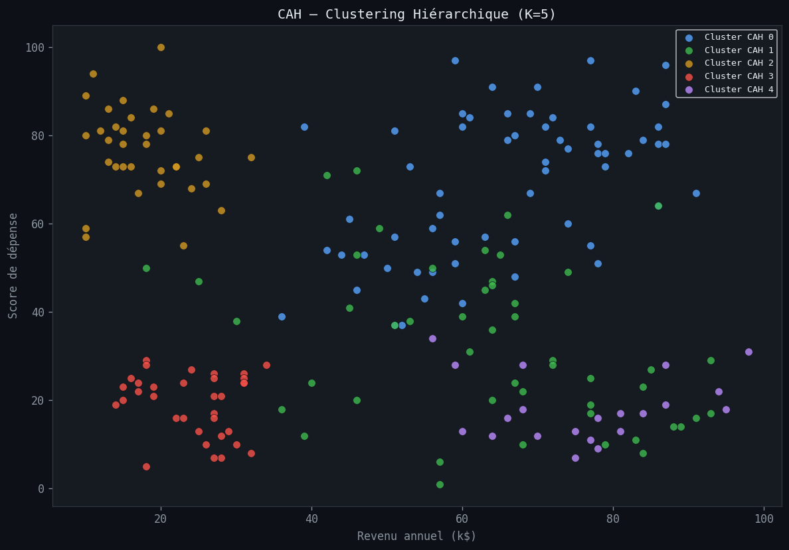
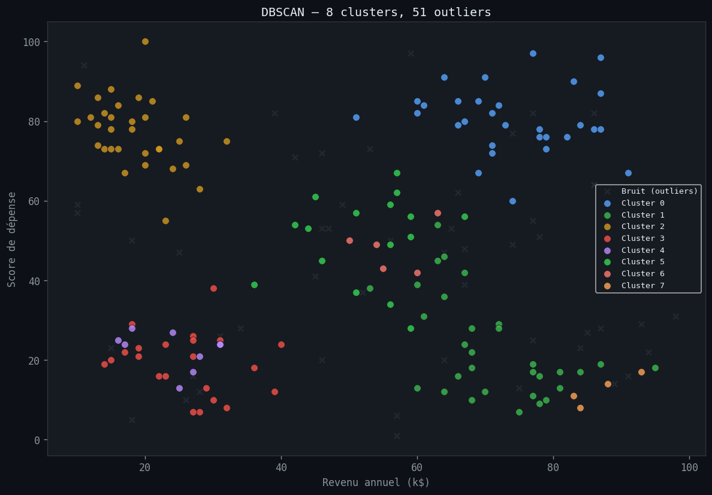
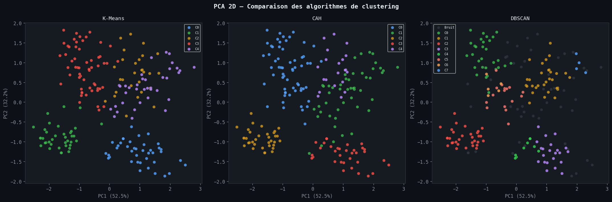

# Segmentation Clients par Clustering

> **Outils** : Python (pandas, numpy, scikit-learn, matplotlib, seaborn, scipy)
> **Duree** : ~6 heures

---

## Problematique metier

Un centre commercial souhaite **mieux comprendre sa clientele** pour personnaliser ses campagnes marketing. Avec **200 clients** decrits par 5 variables (genre, age, revenu annuel, score de depenses), il faut identifier des **groupes homogenes** de clients aux comportements similaires. Le **clustering non supervise** permet de reveler ces segments sans etiquettes predefinies.

> *"Quels profils de clients se degagent naturellement ? Comment adapter les strategies marketing a chaque segment ?"*

---

## Objectifs du projet

- Analyser les **distributions** et **relations** entre les variables clients
- Comparer **3 algorithmes** de clustering : K-Means, CAH (Ward), DBSCAN
- Determiner le **nombre optimal de clusters** (methode Elbow + Silhouette)
- Visualiser les segments en **2D (PCA)** et **3D**
- **Interpreter** les profils de chaque segment
- Formuler des **recommandations marketing** par segment

---

## Outils & competences mobilisees

| Competence | Detail |
|---|---|
| **Python (pandas, numpy)** | Chargement, exploration, statistiques descriptives |
| **scikit-learn** | K-Means, AgglomerativeClustering, DBSCAN, PCA, StandardScaler, metriques |
| **scipy** | Dendrogramme (CAH linkage Ward) |
| **matplotlib / seaborn** | Scatter 2D/3D, Elbow plot, Silhouette, dendrogramme |
| **Analyse non supervisee** | Clustering, evaluation par Silhouette / Davies-Bouldin / Calinski-Harabasz |

---

## Le dataset

**Source** : Mall Customer Segmentation Dataset (Kaggle)

| Variable | Description |
|---|---|
| CustomerID | Identifiant unique du client |
| Gender | Genre (Male / Female) |
| Age | Age du client |
| Annual_Income_k | Revenu annuel (en milliers de dollars) |
| Spending_Score | Score de depenses (1 a 100) |

- **200 clients**
- **5 variables** (1 identifiant + 4 features)
- **Repartition** : Male 44%, Female 56%
- **Statistiques** : Age moyen = 36.3 ans, Revenu moyen = 50.9k, Score moyen = 47.6

---

## Methodologie

### 1. Exploration des donnees (EDA)

- **200 clients**, 5 colonnes
- Distributions de l'age, du revenu et du score de depenses
- Scatter plot Income vs Spending Score : structure de groupes visible a l'oeil

### 2. Preprocessing

- **StandardScaler** applique sur les variables numeriques (Age, Annual_Income_k, Spending_Score)
- Normalisation necessaire pour K-Means et CAH (sensibles a l'echelle)

### 3. Determination du nombre optimal de clusters

- **Methode Elbow** : inertie en fonction de K (coude a K=5)
- **Score Silhouette** : maximum a K=5

### 4. K-Means (K=5)

- 5 clusters identifies
- Silhouette Score = 0.3979
- Davies-Bouldin = 0.9588
- Calinski-Harabasz = 141.6

### 5. CAH — Classification Ascendante Hierarchique (Ward, K=5)

- Dendrogramme avec coupure a 5 clusters
- Silhouette Score = 0.3584

### 6. DBSCAN (eps=0.5, min_samples=5)

- 8 clusters identifies
- 51 outliers (25.5% des observations)
- Moins adapte a ce dataset (nombreux outliers)

### 7. Comparaison et PCA

- PCA 2D : ~76% de la variance expliquee (2 composantes)
- Comparaison visuelle K-Means vs CAH vs DBSCAN en projection PCA

---

## KPIs cles

| Metrique | K-Means (K=5) | CAH Ward (K=5) | DBSCAN |
|---|---|---|---|
| Nombre de clusters | 5 | 5 | 8 |
| Silhouette Score | 0.3979 | 0.3584 | — |
| Davies-Bouldin | 0.9588 | — | — |
| Calinski-Harabasz | 141.6 | — | — |
| Outliers | 0 | 0 | 51 (25.5%) |

**Meilleur algorithme** : K-Means (plus haut score Silhouette)

---

## Les 5 segments identifies (K-Means)

| Segment | Description | Effectif | Part |
|---|---|---|---|
| 1 | Clients Prudents — Revenu faible, depenses faibles | 40 | 20.0% |
| 2 | Depensiers Modestes — Revenu faible, depenses elevees | 38 | 19.0% |
| 3 | Riches Economes — Revenu eleve, depenses faibles | 28 | 14.0% |
| 4 | Clients Premium — Revenu eleve, depenses elevees | 57 | 28.5% |
| 5 | Profil Standard — Revenu et depenses moyens | 37 | 18.5% |

---

## Visualisations



> Dashboard recapitulatif — Distribution des clusters K-Means, repartition des segments, KPIs cles (200 clients, 5 segments, Silhouette = 0.3979).



> Exploration des donnees : distributions de l'age, du revenu annuel et du score de depenses. Scatter plot Income vs Spending Score montrant les groupes naturels.



> Methode Elbow (inertie en fonction de K) et score Silhouette par nombre de clusters. Le coude et le maximum Silhouette convergent vers K=5.



> Projection 2D des 5 clusters K-Means. Chaque couleur represente un segment distinct dans l'espace Income vs Spending Score.



> Visualisation 3D des clusters K-Means integrant Age, Income et Spending Score. La troisieme dimension revele la repartition par age au sein de chaque segment.



> Dendrogramme de la Classification Ascendante Hierarchique (methode Ward). La ligne de coupure a 5 clusters est tracee en pointilles.



> Projection 2D des 5 clusters obtenus par CAH (Ward). Resultat comparable au K-Means avec des frontieres legerement differentes.



> Resultat DBSCAN (eps=0.5, min_samples=5) : 8 clusters et 51 outliers (points noirs). L'algorithme surestime les outliers sur ce dataset.



> Comparaison en projection PCA 2D (~76% de variance expliquee) des trois algorithmes. K-Means et CAH produisent des segmentations coherentes ; DBSCAN montre une fragmentation excessive.

---

## Principaux insights

### Comparaison des algorithmes

- **K-Means** offre la meilleure separation (Silhouette = 0.3979) avec des clusters equilibres
- **CAH (Ward)** produit des resultats similaires (Silhouette = 0.3584) avec l'avantage du dendrogramme
- **DBSCAN** est inadapte ici : 25.5% d'outliers, fragmentation en 8 micro-clusters

### Structure de la clientele

- Le segment le plus important est **Clients Premium** (28.5%) : revenu et depenses eleves
- Les **Depensiers Modestes** (19%) representent un paradoxe : faible revenu mais forte propension a depenser
- Les **Riches Economes** (14%) sous-utilisent leur pouvoir d'achat — opportunite marketing

### Reduction dimensionnelle

- La PCA 2D capture ~76% de la variance avec seulement 2 composantes
- Les projections confirment visuellement la qualite de la segmentation K-Means

---

## Recommandations

1. **Cibler les Clients Premium** (28.5%) avec des offres exclusives et un programme de fidelite VIP
2. **Activer les Riches Economes** (14%) via des campagnes personnalisees pour stimuler leurs depenses
3. **Fideliser les Depensiers Modestes** (19%) avec des offres promotionnelles et du credit
4. **Proposer des offres d'entree de gamme** aux Clients Prudents (20%) pour augmenter leur engagement
5. **Utiliser K-Means** comme algorithme de reference pour la segmentation operationnelle
6. **Mettre a jour** la segmentation trimestriellement avec les nouvelles donnees clients

---

## Competences demontrees

- Clustering non supervise : K-Means, CAH, DBSCAN
- Evaluation de clustering : Silhouette, Davies-Bouldin, Calinski-Harabasz
- Reduction dimensionnelle (PCA) pour la visualisation
- Standardisation des donnees (StandardScaler)
- Visualisation avancee : scatter 2D/3D, dendrogramme, comparaison multi-algorithmes
- Interpretation metier des segments et recommandations marketing

---

## Structure du projet

```
09-customer-segmentation/
├── dataset/
│   └── Mall_Customers.csv
├── notebooks/
│   └── 09_customer_segmentation.ipynb
├── images/
│   ├── 00_dashboard_clustering.png
│   ├── 01_eda.png
│   ├── 02_elbow_silhouette.png
│   ├── 03_kmeans_2d.png
│   ├── 04_kmeans_3d.png
│   ├── 05_dendrogram.png
│   ├── 06_cah_clusters.png
│   ├── 07_dbscan.png
│   └── 08_pca_comparison.png
└── README.md
```

---

## Pour reproduire ce projet

```bash
# 1. Cloner le repo
git clone https://github.com/barde44/portfolio-data-analyst.git
cd portfolio-data-analyst/09-customer-segmentation

# 2. Installer les dependances
pip install pandas numpy matplotlib seaborn scikit-learn scipy

# 3. Lancer le notebook
jupyter notebook notebooks/09_customer_segmentation.ipynb
```

---

## A propos

Portfolio complet : [github.com/barde44/portfolio-data-analyst](https://github.com/barde44/portfolio-data-analyst)
