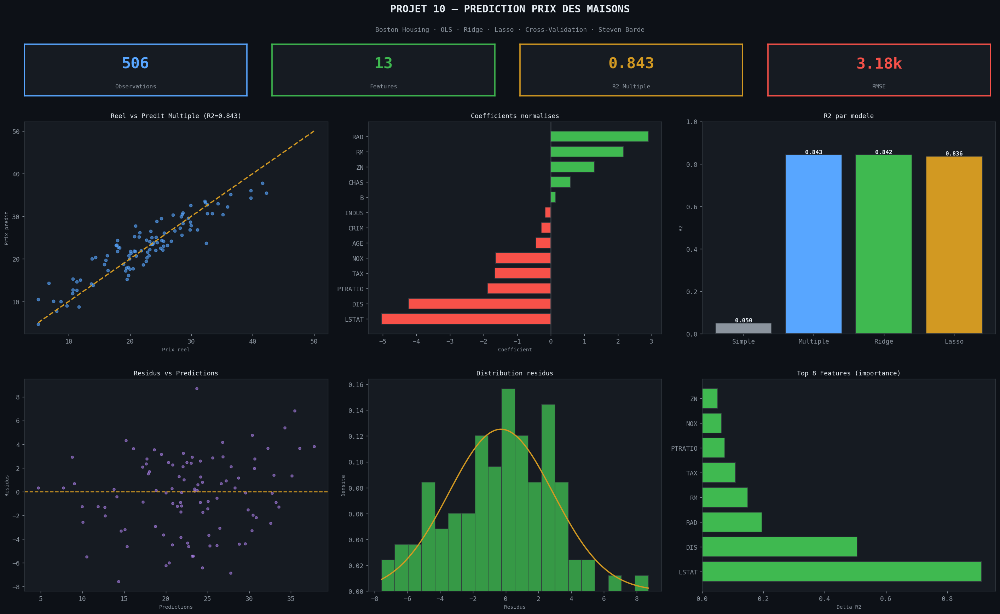
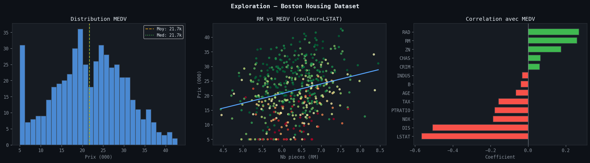
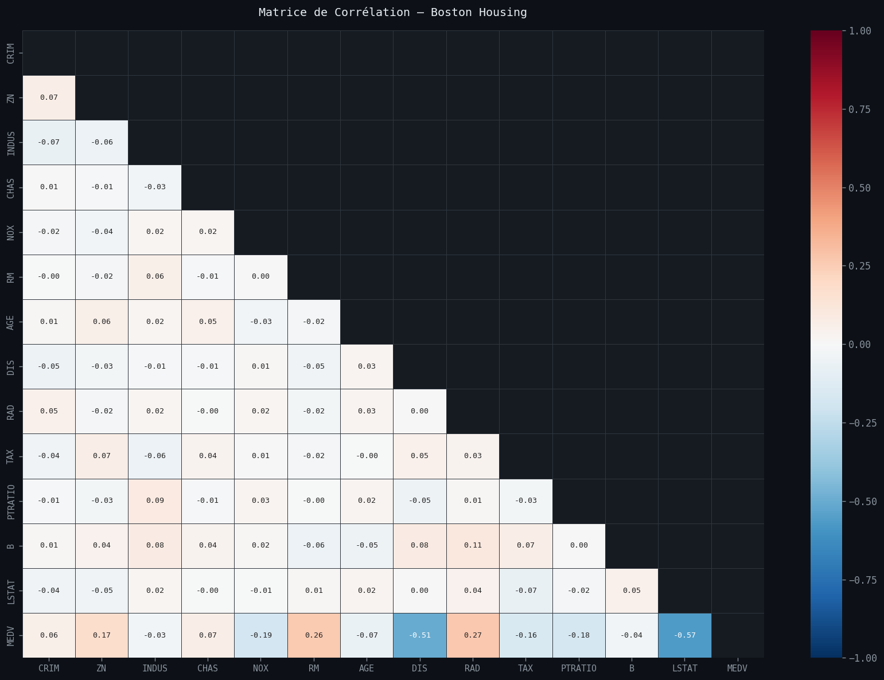
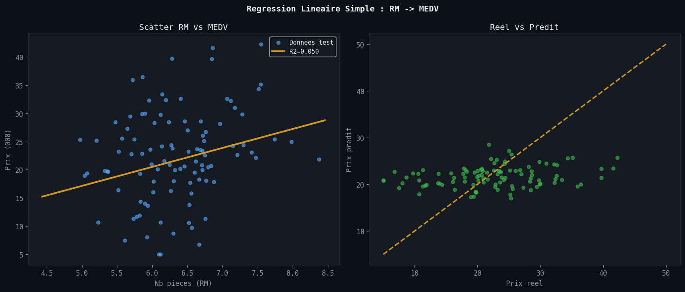
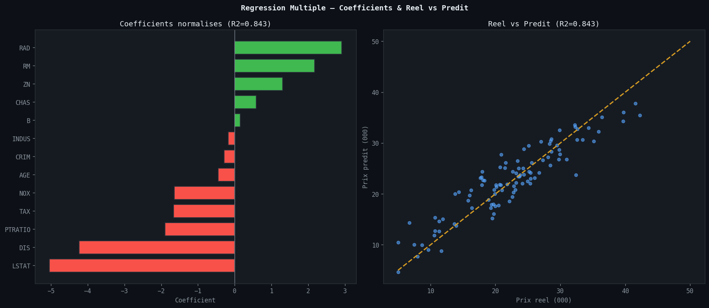
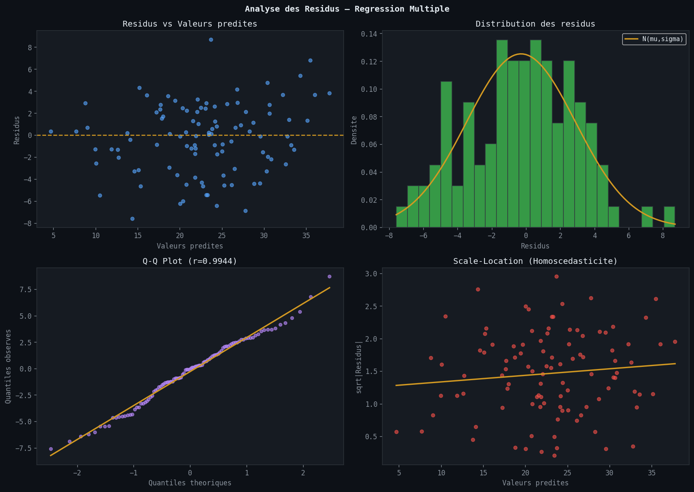
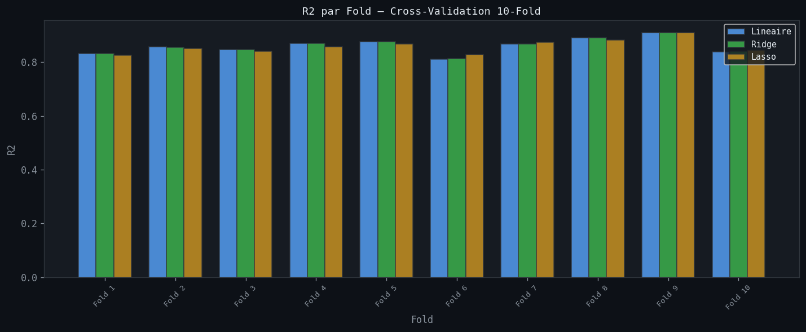
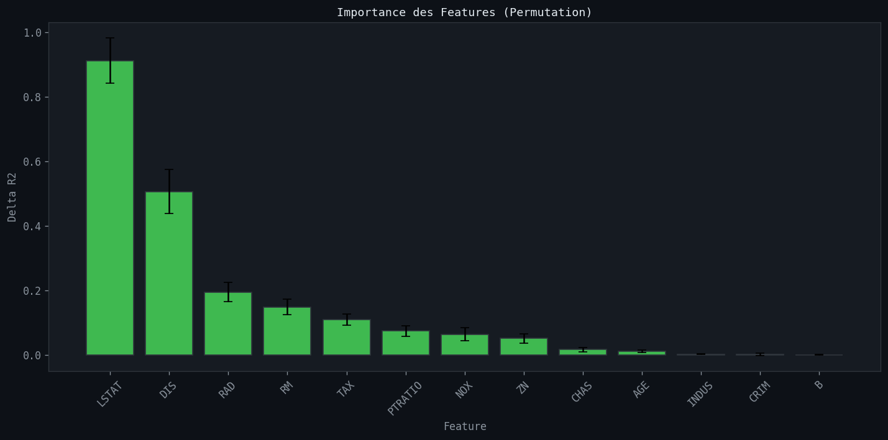

# Prediction des Prix des Maisons -- Regression Lineaire

> **Outils** : Python, scikit-learn, pandas, matplotlib, seaborn, statsmodels, scipy  
> **Duree** : ~6 heures

---

## Problematique metier

Un investisseur immobilier souhaite **estimer le prix median des maisons** dans differents quartiers de la region de Boston. Avec **13 variables socio-economiques et structurelles**, il est essentiel de construire un modele de regression capable de predire les prix et d'identifier les facteurs les plus influents.

> *"Quelles variables determinent le prix d'une maison ? Peut-on construire un modele fiable pour estimer la valeur d'un bien ?"*

---

## Objectifs du projet

- Analyser les **distributions** et **correlations** des 13 variables explicatives
- Construire une **regression lineaire simple** (RM uniquement) comme baseline
- Construire une **regression lineaire multiple** avec les 13 features
- Comparer les performances des modeles **Ridge** et **Lasso** (regularisation)
- Analyser les **residus** (normalite, homoscedasticite, Q-Q plot)
- Evaluer les modeles par **validation croisee 10-fold**
- Identifier les **features les plus importantes** par permutation importance

---

## Outils & competences mobilisees

| Competence | Detail |
|---|---|
| **Python (pandas, numpy)** | Chargement, exploration, statistiques descriptives |
| **scikit-learn** | LinearRegression, Ridge, Lasso, cross_val_score, permutation_importance |
| **statsmodels** | OLS (Ordinary Least Squares), resume statistique complet |
| **scipy** | Test de Shapiro-Wilk sur les residus |
| **matplotlib / seaborn** | Scatter plots, heatmaps, residual plots, bar charts |
| **Evaluation de modeles** | R2, RMSE, MAE, MAPE, validation croisee |

---

## Le dataset

**Source** : Boston Housing Dataset (scikit-learn)

| Variable | Description |
|---|---|
| CRIM | Taux de criminalite par habitant |
| ZN | % de terrain residentiel zone > 25 000 sq.ft. |
| INDUS | % de terrain industriel non-commercial |
| CHAS | Proximite de la riviere Charles (0 ou 1) |
| NOX | Concentration en oxydes d'azote (ppm) |
| RM | Nombre moyen de pieces par logement |
| AGE | % de logements construits avant 1940 |
| DIS | Distance ponderee aux 5 centres d'emploi |
| RAD | Indice d'accessibilite aux autoroutes |
| TAX | Taux de taxe fonciere (pour $10 000) |
| PTRATIO | Ratio eleves/enseignant |
| B | Indice de population |
| LSTAT | % de population de statut socio-economique bas |
| MEDV | Prix median des maisons (en milliers de $) -- cible |

- **506 observations**
- **13 variables explicatives** + 1 variable cible (MEDV)
- **Split** : 80% train (404) / 20% test (102)

---

## Methodologie

### 1. Exploration des donnees (EDA)

- **506 observations**, 14 colonnes
- Prix median (MEDV) : moyenne = 21.7k$, mediane = 21.7k$, min = 5.0k$, max = 42.9k$
- Distribution de MEDV legerement asymetrique a droite avec un pic a 50k$ (censure)

### 2. Matrice de correlation

- Correlations fortes avec MEDV : RM (+), LSTAT (-), PTRATIO (-)
- Multicolinearite detectee entre certaines variables (RAD/TAX, DIS/AGE)

### 3. Regression lineaire simple (baseline)

- Variable unique : RM (nombre moyen de pieces)
- **R2 = 0.050, RMSE = 7.82**
- Performance tres limitee : une seule variable ne suffit pas

### 4. Regression lineaire multiple

- **13 features** utilisees
- **R2 = 0.843, RMSE = 3.18, MAE = 2.55, MAPE = 14.07%**
- Amelioration majeure par rapport a la regression simple

### 5. Modeles regularises

| Modele | R2 | RMSE |
|---|---|---|
| Regression lineaire multiple | 0.843 | 3.18 |
| Ridge (alpha=1.0) | 0.842 | 3.18 |
| Lasso (alpha=0.1) | 0.836 | 3.25 |

### 6. Analyse OLS (statsmodels)

- **R-squared = 0.879**, Adj R-squared = 0.875
- Variables significatives (p<0.05) : ZN, CHAS, NOX, RM, AGE, DIS, RAD, TAX, PTRATIO, LSTAT
- Test de Shapiro-Wilk applique sur les residus

### 7. Validation croisee 10-fold

- Evaluation robuste de la performance par cross-validation

### 8. Feature importance (permutation)

- **Top 3** : LSTAT, DIS, RAD
- LSTAT (% population statut bas) est le predicteur le plus influent

---

## Visualisations



> Dashboard recapitulatif -- Comparaison des modeles (R2, RMSE), coefficients de regression, reel vs predit, et KPIs cles : 506 observations, 13 features, R2 = 0.843 pour le modele multiple.



> Exploration des donnees : distributions des variables, scatter plot RM vs MEDV, correlations principales avec la variable cible.



> Matrice de correlation 14x14. Correlations fortes : RM/MEDV (+), LSTAT/MEDV (-), RAD/TAX (+). Identification des variables multicolineaires.



> Regression lineaire simple : RM (nombre moyen de pieces) comme unique predicteur de MEDV. R2 = 0.050, droite de regression peu ajustee.



> Regression lineaire multiple : coefficients standardises et scatter plot reel vs predit (R2 = 0.843). Les coefficients montrent l'impact relatif de chaque variable.



> Analyse des residus : scatter plot residus vs predit, histogramme des residus, Q-Q plot, scale-location. Verification de la normalite et de l'homoscedasticite.



> Validation croisee 10-fold : R2 par fold pour les 3 modeles (lineaire, Ridge, Lasso). Evaluation de la stabilite et de la generalisation.



> Importance des features par permutation. LSTAT, DIS et RAD sont les 3 variables les plus influentes pour la prediction du prix.

---

## Principaux insights

### Performance des modeles

| Modele | R2 | RMSE | MAE | MAPE |
|---|---|---|---|---|
| Regression simple (RM) | 0.050 | 7.82 | -- | -- |
| Regression multiple (13 var.) | 0.843 | 3.18 | 2.55 | 14.07% |
| Ridge (alpha=1.0) | 0.842 | 3.18 | -- | -- |
| Lasso (alpha=0.1) | 0.836 | 3.25 | -- | -- |
| OLS (statsmodels) | 0.879 | -- | -- | -- |

### Variables cles

- **LSTAT** (% statut socio-economique bas) : predicteur le plus important par permutation
- **DIS** (distance aux centres d'emploi) : forte influence sur le prix
- **RAD** (accessibilite autoroutes) : impact significatif
- **10 variables sur 13** significatives dans le modele OLS (p<0.05)

### Regularisation

- Ridge et Lasso produisent des performances tres proches du modele lineaire standard
- Le faible ecart suggere une absence de surapprentissage majeur
- La regularisation confirme la robustesse du modele lineaire

---

## Recommandations

1. **Utiliser la regression multiple** (13 features) comme modele de reference (R2 = 0.843)
2. **Surveiller LSTAT et DIS** comme indicateurs prioritaires pour l'estimation immobiliere
3. **Tester des modeles non-lineaires** (Random Forest, Gradient Boosting) pour capturer les relations complexes
4. **Explorer l'ingenierie de features** (interactions, transformations polynomiales) pour ameliorer le MAPE
5. **Collecter des donnees supplementaires** (surface habitable, etat du bien, annee de renovation) pour enrichir le modele

---

## Competences demontrees

- Regression lineaire simple et multiple avec scikit-learn
- Regularisation (Ridge, Lasso) et comparaison de modeles
- Analyse OLS complete avec statsmodels (p-values, R-squared ajuste)
- Analyse des residus (normalite, homoscedasticite, Shapiro-Wilk)
- Validation croisee K-fold pour l'evaluation robuste
- Feature importance par permutation
- Visualisation avancee des resultats de regression

---

## Structure du projet

```
10-house-price-regressiondataset/
├── dataset/
│   └── boston_housing.csv
├── notebooks/
│   └── 10_house_price_regression.ipynb
├── images/
│   ├── 00_dashboard_regression.png
│   ├── 01_eda_boston.png
│   ├── 02_correlation_matrix.png
│   ├── 03_regression_simple.png
│   ├── 04_regression_multiple.png
│   ├── 05_residuals.png
│   ├── 06_cross_validation.png
│   └── 07_feature_importance.png
└── README.md
```

---

## Pour reproduire ce projet

```bash
# 1. Cloner le repo
git clone https://github.com/barde44/portfolio-data-analyst.git
cd portfolio-data-analyst/10-house-price-regressiondataset

# 2. Installer les dependances
pip install pandas numpy matplotlib seaborn scikit-learn statsmodels scipy

# 3. Lancer le notebook
jupyter notebook notebooks/10_house_price_regression.ipynb
```

---

## A propos

Portfolio complet : [github.com/barde44/portfolio-data-analyst](https://github.com/barde44/portfolio-data-analyst)
