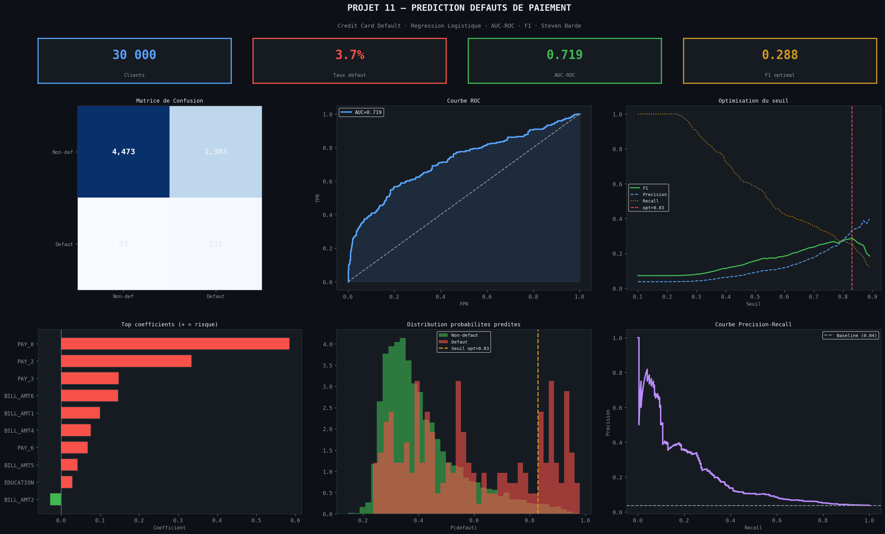
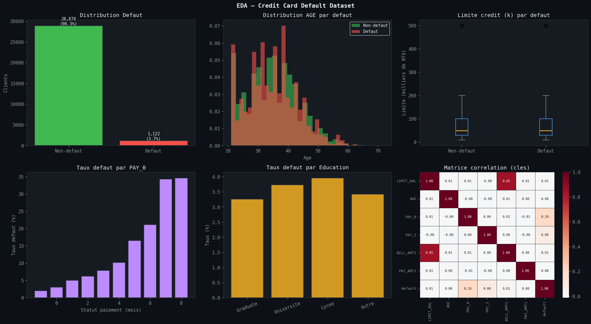
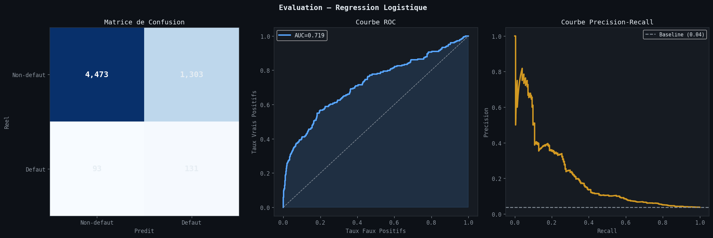
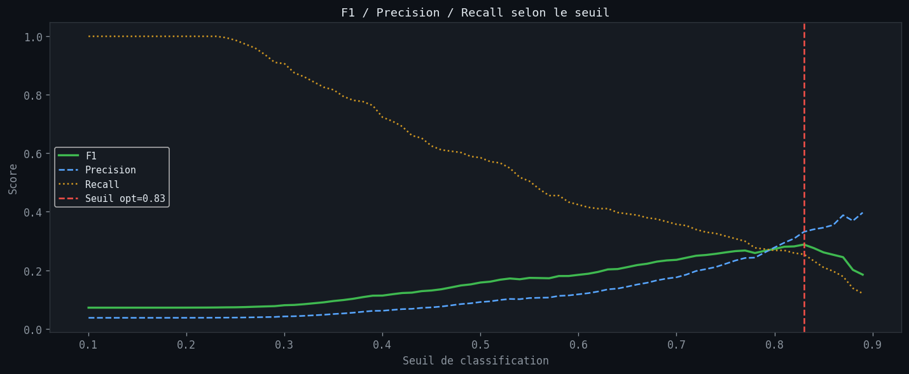
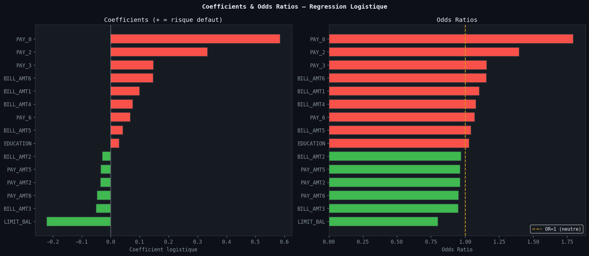

# Prediction des Defauts de Paiement — Regression Logistique

> **Outils** : Python, scikit-learn, pandas, matplotlib, seaborn, imbalanced-learn  
> **Duree** : ~6 heures

---

## Problematique metier

Un etablissement financier souhaite **predire les defauts de paiement** de ses clients de cartes de credit. Avec un taux de defaut de seulement **3,7%**, le jeu de donnees est fortement desequilibre. La **regression logistique** avec ponderation des classes permet d'identifier les profils a risque tout en gerant ce desequilibre.

> *« Peut-on predire fiablement un defaut de paiement a partir de l'historique de remboursement et des caracteristiques du client ? »*

---

## Objectifs du projet

- Analyser la distribution des variables et le desequilibre des classes (3,7% de defaut)
- Appliquer une **regression logistique** avec `class_weight="balanced"` pour gerer le desequilibre
- Evaluer les performances via **AUC-ROC**, **F1-score**, **precision** et **recall**
- Optimiser le **seuil de decision** pour maximiser le F1-score
- Interpreter les **coefficients logistiques** et **odds ratios** pour identifier les facteurs de risque
- Valider la robustesse via **cross-validation stratifiee 5-fold**

---

## Outils & competences mobilisees

| Competence | Detail |
|---|---|
| **Python (pandas, numpy)** | Chargement, exploration, preprocessing |
| **scikit-learn** | LogisticRegression, LDA, cross-validation, metrics |
| **imbalanced-learn** | Gestion du desequilibre des classes |
| **matplotlib / seaborn** | Confusion matrix, ROC, precision-recall, coefficients |
| **Classification binaire** | Regression logistique, seuil optimal, evaluation multi-metrique |

---

## Le dataset

**Source** : Credit Card Default Dataset — 30 000 clients

| Variable | Description |
|---|---|
| LIMIT_BAL | Montant du credit accorde |
| SEX | Sexe du client |
| EDUCATION | Niveau d'education (1=Graduate, 2=University, 3=High school, 4=Other) |
| MARRIAGE | Statut marital |
| AGE | Age du client |
| PAY_0 a PAY_6 | Statut de paiement (-1=OK, 0=revolving, 1-8=mois de retard) |
| BILL_AMT1 a BILL_AMT6 | Montant des factures (6 mois) |
| PAY_AMT1 a PAY_AMT6 | Montant des paiements (6 mois) |
| default | Variable cible (1=defaut, 0=pas de defaut) |

- **30 000 clients**
- **23 features** + 1 variable cible
- **Taux de defaut : 3,7%** (dataset desequilibre)

---

## Methodologie

### 1. Exploration des donnees (EDA)

- **30 000 observations**, 24 colonnes
- Taux de defaut : **3,7%** — forte asymetrie des classes
- Distribution analysee par age, credit limit, education et historique de paiement (PAY_0)

### 2. Preprocessing et split

- Split **80/20** stratifie : 24 000 train / 6 000 test
- Modele : Regression logistique avec `class_weight="balanced"`
- Comparaison avec LDA (Linear Discriminant Analysis)

### 3. Evaluation du modele (seuil 0.5)

| Metrique | Valeur |
|---|---|
| Accuracy | 0.7673 |
| Precision | 0.0914 |
| Recall | 0.5848 |
| F1-score | 0.1580 |
| AUC-ROC | 0.7194 |

### 4. Optimisation du seuil de decision

| Seuil | F1-score |
|---|---|
| 0.50 (defaut) | 0.1580 |
| **0.83 (optimal)** | **0.2879** |

- Le seuil optimal a 0.83 augmente significativement le F1-score (+82%)
- Compromis precision/recall ajuste pour reduire les faux positifs

### 5. Matrice de confusion (seuil optimal)

|  | Predit Negatif | Predit Positif |
|---|---|---|
| **Reel Negatif** | TN = 4 473 | FP = 1 303 |
| **Reel Positif** | FN = 93 | TP = 131 |

### 6. Cross-validation stratifiee (5-fold)

| Metrique | Moyenne | Ecart-type |
|---|---|---|
| AUC-ROC | 0.7169 | 0.0129 |
| F1-score | 0.1520 | — |
| Accuracy | 0.7659 | — |

- Resultats stables entre les folds (faible ecart-type AUC)
- Pas de surapprentissage detecte

---

## Visualisations



> Dashboard recapitulatif — Metriques du modele logistique (AUC=0.719), distribution des classes, matrice de confusion, courbe ROC et principaux coefficients. Vue d'ensemble des performances sur 30 000 clients.



> Analyse exploratoire : distribution des defauts (3,7%), repartition par age et credit limit, taux de defaut selon PAY_0 et education, matrice de correlation des 23 features.



> Matrice de confusion, courbe ROC (AUC = 0.719) et courbe precision-recall. La courbe ROC montre une capacite discriminante moderee du modele.



> Evolution du F1-score, de la precision et du recall en fonction du seuil de decision. Le seuil optimal (0.83) maximise le F1-score a 0.2879.



> Coefficients de la regression logistique et odds ratios associes. PAY_0 est le predicteur le plus puissant du defaut, suivi de BILL_AMT1 et LIMIT_BAL.

---

## Principaux insights

### Facteurs de risque identifies

| Variable | Effet | Interpretation |
|---|---|---|
| PAY_0 | Tres fort (positif) | Le retard de paiement le plus recent est le meilleur predicteur |
| BILL_AMT1 | Fort | Les montants factures eleves augmentent le risque |
| LIMIT_BAL | Protecteur (negatif) | Un credit limit eleve reduit le risque de defaut |

### Performance du modele

- L'**AUC-ROC de 0.7194** indique une capacite discriminante moderee
- Le **recall de 0.5848** (seuil 0.5) permet de detecter ~59% des defauts
- L'**optimisation du seuil** a 0.83 ameliore le F1 de 0.1580 a 0.2879
- La **cross-validation** confirme la stabilite du modele (AUC std = 0.0129)

### Limites identifiees

- Le taux de defaut tres faible (3,7%) rend la classification difficile
- La precision reste faible (beaucoup de faux positifs) meme apres optimisation du seuil
- Un modele plus complexe (Random Forest, XGBoost) pourrait ameliorer les performances

---

## Recommandations

1. **Utiliser PAY_0 comme indicateur principal** de risque de defaut de paiement
2. **Ajuster le seuil de decision** selon le cout metier des faux positifs vs faux negatifs
3. **Combiner avec des modeles ensemblistes** (Random Forest, Gradient Boosting) pour ameliorer la precision
4. **Mettre en place un scoring en temps reel** base sur l'historique de paiement recent
5. **Explorer le surechantillonnage** (SMOTE) pour mieux gerer le desequilibre des classes

---

## Competences demontrees

- Regression logistique avec gestion du desequilibre des classes
- Evaluation multi-metrique (AUC-ROC, F1, precision, recall)
- Optimisation du seuil de decision pour la classification binaire
- Cross-validation stratifiee et validation de la robustesse
- Interpretation des coefficients logistiques et odds ratios
- Visualisation de courbes ROC, precision-recall et matrices de confusion

---

## Structure du projet

```
11-credit-default-logistic/
├── dataset/
│   └── credit_default.csv
├── notebooks/
│   └── 11_credit_default_logistic.ipynb
├── images/
│   ├── 00_dashboard_logistic.png
│   ├── 01_eda_credit.png
│   ├── 02_confusion_roc.png
│   ├── 03_threshold_optimization.png
│   └── 04_coefficients_odds.png
└── README.md
```

---

## Pour reproduire ce projet

```bash
# 1. Cloner le repo
git clone https://github.com/barde44/portfolio-data-analyst.git
cd portfolio-data-analyst/11-credit-default-logistic

# 2. Installer les dependances
pip install pandas numpy matplotlib seaborn scikit-learn imbalanced-learn

# 3. Lancer le notebook
jupyter notebook notebooks/11_credit_default_logistic.ipynb
```

---

## A propos

Portfolio complet : [github.com/barde44/portfolio-data-analyst](https://github.com/barde44/portfolio-data-analyst)
