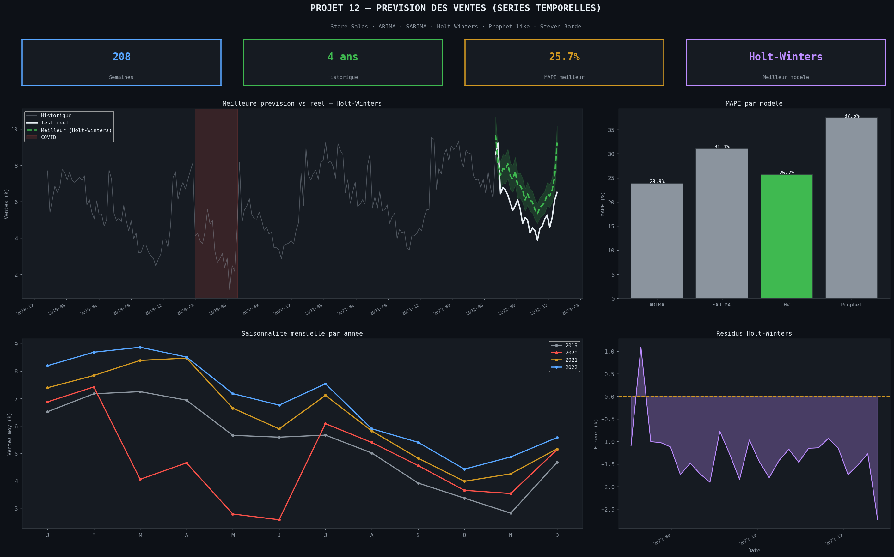
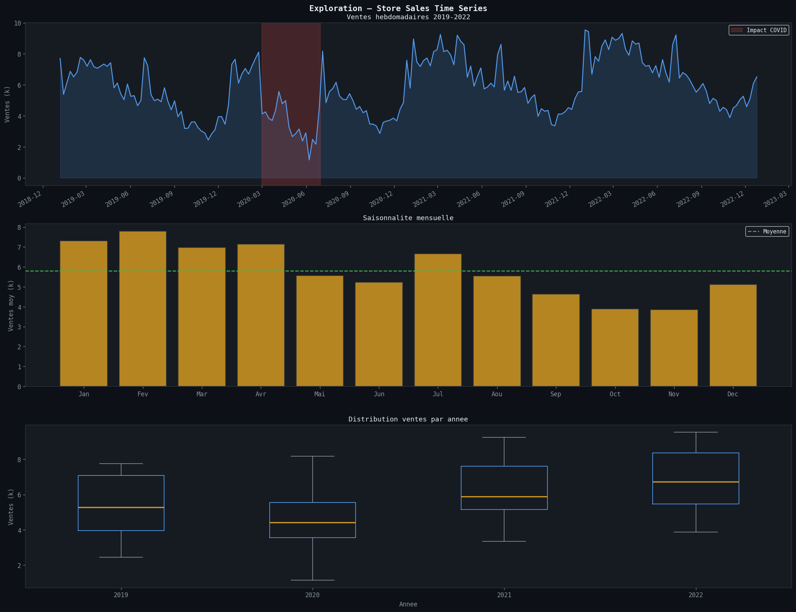
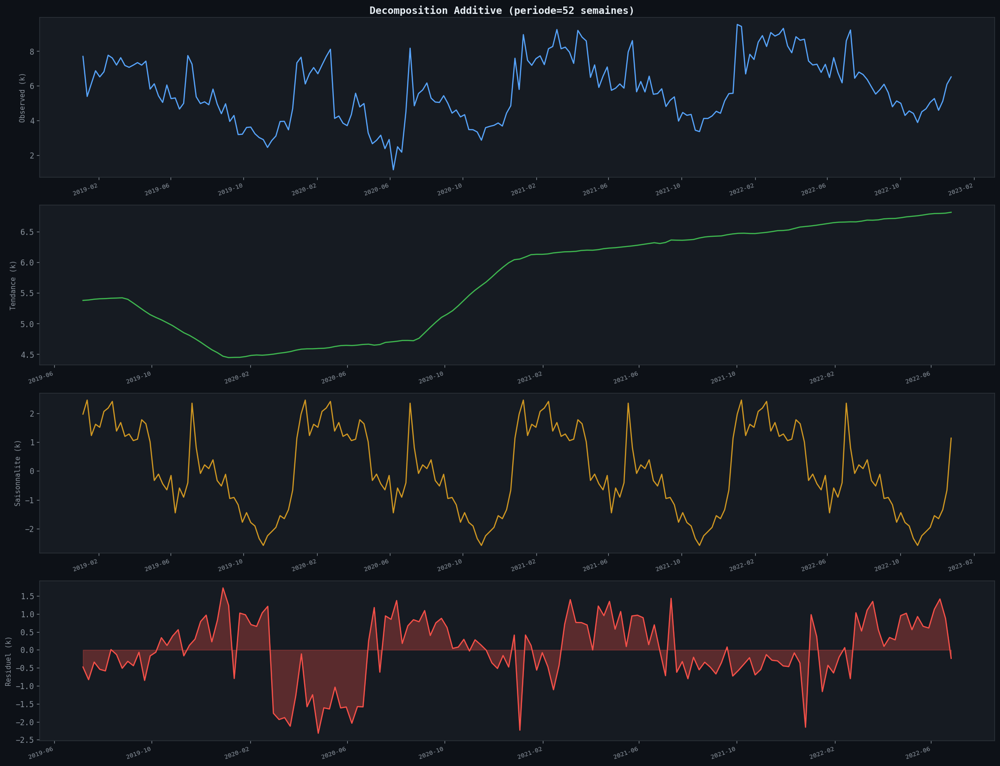
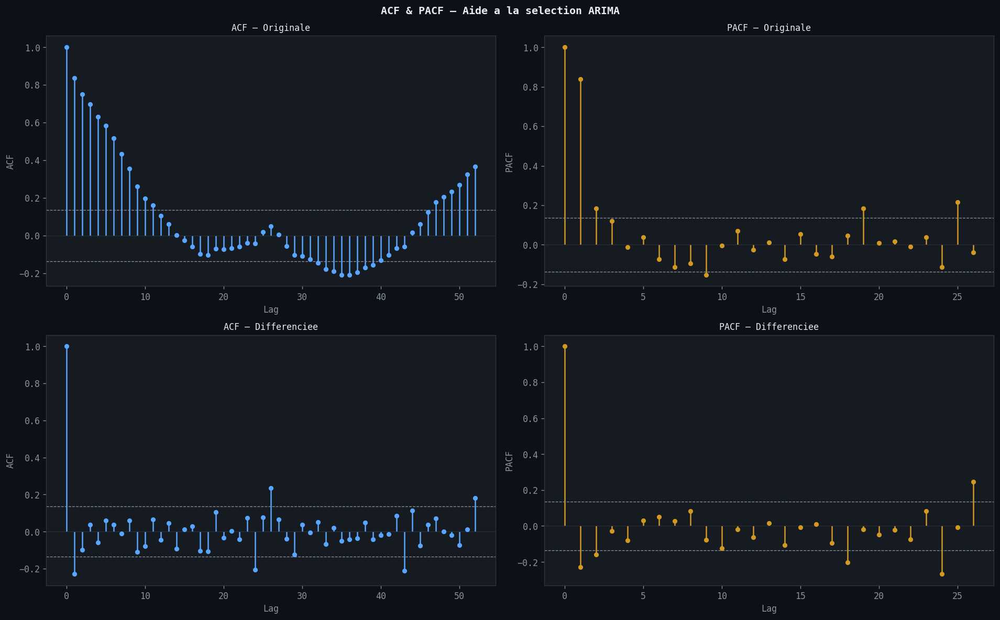
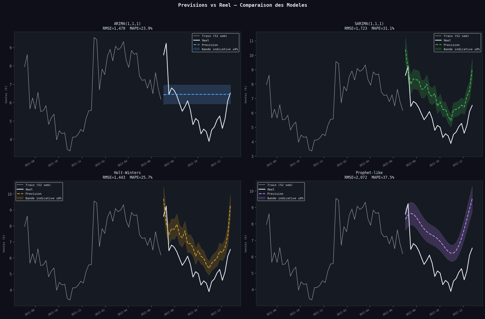

# Prevision des Ventes -- Series Temporelles

> **Outils** : Python, statsmodels (ARIMA/SARIMAX), pandas, matplotlib, scikit-learn  
> **Duree** : ~6 heures

---

## Problematique metier

Un distributeur souhaite **anticiper ses volumes de ventes hebdomadaires** pour optimiser ses stocks, planifier ses promotions et gerer ses ressources logistiques. Avec **208 semaines de donnees** (2019--2022), la serie presente une **tendance croissante**, une **saisonnalite annuelle marquee** et un **choc COVID** au premier semestre 2020. L'objectif est de comparer plusieurs modeles de series temporelles pour identifier celui qui capture le mieux ces dynamiques.

> *"Quel modele de prevision permet de capturer la tendance, la saisonnalite et les chocs exogenes pour prevoir les ventes a 6 mois ?"*

---

## Objectifs du projet

- Explorer et decomposer la serie temporelle (tendance, saisonnalite, residus)
- Tester la stationnarite via le **test ADF** et determiner l'ordre de differenciation
- Analyser les fonctions **ACF et PACF** pour guider le choix des parametres
- Entrainer et comparer **4 modeles** : ARIMA, SARIMA, Holt-Winters, Prophet-like
- Evaluer les performances sur un jeu de test de **26 semaines** (RMSE, MAE, MAPE)
- Identifier le meilleur modele et formuler des recommandations operationnelles

---

## Outils & competences mobilisees

| Competence | Detail |
|---|---|
| **Python (pandas)** | Manipulation, agregation hebdomadaire, split train/test |
| **statsmodels** | ARIMA, SARIMAX, ExponentialSmoothing (Holt-Winters) |
| **scikit-learn** | Metriques (RMSE, MAE, MAPE) |
| **matplotlib** | Visualisation des series, decomposition, previsions |
| **Analyse de series temporelles** | Test ADF, ACF/PACF, decomposition additive |

---

## Le dataset

**Source** : Store Sales Time Series -- ventes hebdomadaires agregees

| Caracteristique | Valeur |
|---|---|
| Periode | 2019-01-06 au 2022-12-25 |
| Frequence | Hebdomadaire |
| Nombre d'observations | 208 semaines |
| Ventes min | 1 151 |
| Ventes max | 9 543 |
| Ventes moyenne | 5 791 |

- **Tendance** : croissance de +8 unites/semaine avec acceleration quadratique
- **Saisonnalite** : annuelle (periode = 52 semaines), pics en ete (juillet) et fin d'annee (decembre)
- **Choc COVID** : chute de -3 500 unites au Q1-Q2 2020 (mars-juin)
- **Evenements promotionnels** : Nouvel An, Noel, Ete, Paques

---

## Methodologie

### 1. Exploration et analyse descriptive

- **208 semaines** de donnees (2019--2022)
- Tendance croissante avec acceleration quadratique
- Saisonnalite annuelle claire (pics ete + Noel)
- Choc COVID visible au premier semestre 2020

### 2. Decomposition additive

- Modele additif avec periode = 52 semaines
- Composantes extraites : Observed, Trend, Seasonal, Residual
- La composante saisonniere montre des pics reguliers en juillet et decembre

### 3. Test de stationnarite

- **Test ADF** sur la serie originale : **NON STATIONNAIRE**
- **Test ADF** apres differenciation (d=1) : **STATIONNAIRE**
- Analyse ACF/PACF sur la serie originale et differenciee

### 4. Modelisation et prevision

| Modele | RMSE | MAE | MAPE |
|---|---|---|---|
| ARIMA(1,1,1) | 1 470 | 1 226 | 23.87% |
| SARIMA(1,1,1)(1,1,0,52) | 1 723 | 1 666 | 31.10% |
| Holt-Winters | 1 443 | 1 384 | 25.71% |
| Prophet-like | 2 072 | 1 974 | 37.47% |

**Split** : Train = 182 semaines, Test = 26 semaines (2022-07-03 au 2022-12-25)

---

## Visualisations



> Dashboard recapitulatif -- Meilleure prevision (Holt-Winters), comparaison MAPE des 4 modeles, saisonnalite annuelle et analyse des residus.



> Ventes hebdomadaires 2019-2022 avec zone de choc COVID, saisonnalite mensuelle et boxplots annuels.



> Decomposition additive (periode = 52 semaines) : serie observee, tendance, composante saisonniere et residus.



> Fonctions d'autocorrelation (ACF) et d'autocorrelation partielle (PACF) pour la serie originale et la serie differenciee (d=1).



> Previsions des 4 modeles comparees aux ventes reelles sur la periode de test (26 semaines).

---

## Principaux insights

### Performances des modeles

| Modele | RMSE | Observation |
|---|---|---|
| **Holt-Winters** | **1 443** | Meilleur RMSE -- capture tendance + saisonnalite |
| ARIMA(1,1,1) | 1 470 | Bon MAPE (23.87%) mais sans composante saisonniere |
| SARIMA(1,1,1)(1,1,0,52) | 1 723 | Saisonnalite integree mais RMSE plus eleve |
| Prophet-like | 2 072 | Moins performant sur cette serie |

### Dynamiques de la serie

- La **tendance croissante** (+8 unites/semaine) est bien capturee par Holt-Winters et ARIMA
- La **saisonnalite annuelle** (52 semaines) est un facteur cle -- les modeles sans cette composante perdent en precision
- Le **choc COVID** (Q1-Q2 2020) reste un defi pour tous les modeles qui s'appuient sur l'historique
- L'**acceleration quadratique** de la tendance favorise les modeles adaptatifs (lissage exponentiel)

### Limites identifiees

- Aucun modele ne descend sous 20% de MAPE -- les evenements promotionnels et le choc COVID introduisent une variabilite non capturee
- SARIMA sous-performe malgre la composante saisonniere, possiblement a cause d'un sur-ajustement sur le train
- La serie est courte (4 ans) pour estimer robustement des parametres saisonniers annuels

---

## Recommandations

1. **Deployer Holt-Winters** comme modele de prevision operationnel (meilleur RMSE = 1 443)
2. **Recalibrer mensuellement** le modele pour integrer les derniers points et maintenir la precision
3. **Ajouter des variables exogenes** (promotions, jours feries, meteo) via SARIMAX pour ameliorer la capture des pics
4. **Surveiller les residus** en continu -- un changement structurel (nouveau choc) necessite une re-estimation
5. **Explorer des approches ML** (XGBoost, LSTM) si la serie s'allonge au-dela de 5 ans

---

## Competences demontrees

- Analyse exploratoire de series temporelles (tendance, saisonnalite, choc)
- Test de stationnarite (ADF) et differenciation
- Analyse ACF/PACF pour le choix des parametres ARIMA
- Decomposition additive (statsmodels)
- Modelisation ARIMA, SARIMA, Holt-Winters et Prophet-like
- Evaluation comparative (RMSE, MAE, MAPE) sur jeu de test
- Visualisation de previsions vs donnees reelles

---

## Structure du projet

```
12-sales-forecasting-timeseries/
├── dataset/
│   └── store_sales_weekly.csv
├── notebooks/
│   └── 12_sales_forecasting_timeseries.ipynb
├── images/
│   ├── 00_dashboard_timeseries.png
│   ├── 01_time_series_eda.png
│   ├── 02_decomposition.png
│   ├── 03_acf_pacf.png
│   └── 04_forecasts_comparison.png
└── README.md
```

---

## Pour reproduire ce projet

```bash
# 1. Cloner le repo
git clone https://github.com/barde44/portfolio-data-analyst.git
cd portfolio-data-analyst/12-sales-forecasting-timeseries

# 2. Installer les dependances
pip install pandas numpy matplotlib statsmodels scikit-learn

# 3. Lancer le notebook
jupyter notebook notebooks/12_sales_forecasting_timeseries.ipynb
```

---

## A propos

Portfolio complet : [github.com/barde44/portfolio-data-analyst](https://github.com/barde44/portfolio-data-analyst)
